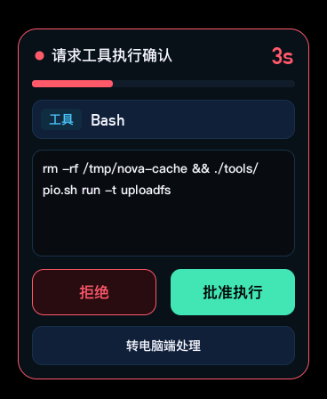

# 鲸鱼娘桌面宠物 · Nova Buddy（ESP32-S3 AMOLED）

基于 **Waveshare ESP32-S3-Touch-AMOLED-1.8（368×448）** 打造的桌面 AI 副屏：它看得见你在 DeepSeek Harness 里跑的几个会话卡在哪一步，能替你把工具审批点掉，也能**按住说一句话**——那句话会真的送进你的宿主会话，回复压缩后回到这块 1.8 寸屏上。

<p align="center">
  
  
  
  
</p>

## 它是什么

不是聊天机器人，是桌面的状态端点。

你坐在电脑前时它基本不需要你管，只在你回头的那一秒显示「三个窗口分别在干什么」。你离开键盘时，它是唯一还能说话的地方——按住说一句，那句话进的是**同一个会话**，不是旁边一个独立的小模型。

三种时刻：**巡检**（默认，只读）、**审批**（最高优先级）、**说话**（一次投递）。

## 怎么玩

### 按住说一句话

1. 按住底部那条「按住说话」。屏幕变黑，波形跟着声音走，上面是秒数；说错了直接往上滑，松手就取消。
2. 松手出「识别到」卡片，你刚说的话在上面。屏幕下面是「发往 · 某个会话」和「换一个」。
3. 核对一眼：对了点「发送」，错了点「取消重说」。**它不会自己发**——没有倒计时，不会替你决定。
4. 发送后同一张卡跟到底：`已送达` → `在跑 · N 秒` → 正文 + `播报`。屏上的字和喇叭里的话是同一句，都在 40 个显示宽度以内。

目标是**正在跑**的会话时，按钮变成「排队 / 打断」——注入正在干活的会话等于打断它，这个决定不该由它替你下。

这些话真的进你的会话：电脑那个窗口里会多出一条用户消息，`source.rpcId` 是 `设备ID:片段号:序号`。回复也是那个会话说的，不是另一个人。

### 一眼看全几个会话

主界面是三张会话卡：谁在跑（青色呼吸点 + 已跑时长）、谁在等审批（琥珀条 + 命令预览）、谁停着（灰点 + 停了多久）。点一张就展开它最近三步工具调用，同时把它设成投递目标——整卡高亮、左侧青条、右上角打勾，三处一起变，不用读字。再点一次取消。

底下一条「上次播报」：你不在电脑前时错过的最后一句话，点一下重播。

### 在它上面点同意

审批是琥珀色卡片压上来：命令原文 + 一句人话说明影响（「会删除 6 个测试录音」），20 秒没人处理自动拒绝。设备本来就是干这个最顺手的——它带着 `apId`，不怕会话换段，也不用你切窗口。

### 其他几屏

左右滑动循环：**Token 累计**（按天折线，读的是会话日志不是内存）→ **宠物主屏**（Nova 动画 + 运行/等待/上下文占比）→ **额度**（DeepSeek 余额、OpenCode Go / OpenDesign 周期额度）→ **榜单**（ModelDial 24 款编码模型，可滑动、可切维度）→ **详情** → **会话看板**。设置页在左上箭头或 Key1 进出，6 组 16 行一页清单。

---

## 核心特性

- **按住说话 → 会话注入 → 单卡回执**：设备录音 16kHz/16bit 分片上行，宿主插件重组后走小米 MiMo ASR，识别文本回到屏上给你确认；确认后通过 `sessionController.follow + prompt({requestId})` 注入宿主会话，用 `source.rpcId` 认领这一轮，`turn/end` 之后取正文压缩成 **40 显示宽度**回推并播报。摘要压缩走宿主侧一次性小模型调用，工作会话本身不改 prompt、不挂工具，电脑端体验零侵入。TTS 端在宿主侧把 ADPCM 采样数限到 196500（≈12.28s）并做 80ms 淡出，从根上消掉「超 96KB 被固件静默丢弃」。

- **原生 `368×448` AMOLED · 60fps 局部脏矩形渲染**：主屏 Nova 鲸鱼娘 `NVA2` 96 色高清帧动画（162px 统一等比、纯黑抗锯齿融合与 XOR 帧间压缩）通过 PSRAM 解码与内部 SRAM 分带 DMA 局部刷新，实测稳定跑满 **60 fps**；全屏滑动切页采用 `180ms` PSRAM 双缓存平滑 `easeOutCubic` 合成。
- **统一细腻微交互动效（`src/ui/easing.h`）**：收敛 `outCubic / outQuart / outBack / approachFactor` 缓动体系，支持审批弹窗升起/下沉（`POP_IN / POP_OUT`）、滑屏弹性圆点跟随、按下反馈 60ms 淡入 / 120ms 局部回落、开关 140ms 滑动变色、滑块抓取 1.25× 缩放与 35ms 阻尼平滑、设置抽屉渐显上移、Token 鲸鱼选中渐变脉冲与 AOD 进出背光两段式渐变，静态自动回落低帧率省电。
- **LVGL 风格 `4-bpp` 抗锯齿字体与 AA 几何图元**：`PingFang SC`（覆盖 ASCII + GB2312 一级 3,755 常用字与 UI/宠萌补充字符，共 3,902 字形）+ `DIN Alternate Bold` 数字仪表字体，配合亚像素抗锯齿圆角卡片、顶部胶囊、圆点与进度条。
- **六页滑动环 + 设置页 + 审批模态弹窗**：
  - **会话看板**：三张会话卡（在跑 / 等审批 / 停着）+ 上次播报；点卡展开最近三步并设为投递目标，其余卡压成单行。视觉基准见 `docs/design/voice-bridge-final.html`。
  - **宠物主屏**：运行/等待/会话统计、上下文占比、`st.msg` 实时工具/异常状态提示，支持轻触 Nova 互动粒子与醒来反馈、空白处点按跑动与自动编排剧本。
  - **订阅额度**：DeepSeek 账户余额（CNY）、OpenCode Go 与 OpenDesign 周期额度条，本地实时递增数据年龄与重置倒计时，轻触卡片可立即触发宿主同步。
  - **ModelDial 榜单**：同步 24 款主流编码模型，支持**触摸实时上下滑动**与点击右上角切换 **`B·F·K 维度`** / **`审美·耗时`**。
  - **Token 累计**：按天折线 + 总量/命中率；数据直接读会话日志（`ctx.sessions` 只列 live session，拿不到历史），60s 一轮增量刷新，内容不变不重发。
  - **设置（一页清单，6 组 16 行）**：`屏幕 / 熄屏显示 / 声音 / 电池 / 行为 / 设备`。按「你什么时候会想到它」分组，值永远在行右边；点行原地展开选项，不跳页、不换 tab。**亮度和音量是滑块**（亮度 20–100%、音量 0–100%，5% 步进，拖到底推上去即生效），其余是 3–4 段选项、开关或动作。危险动作（重新配网 / 恢复默认）要连点两次，3 秒不点自动撤销。
- **AOD 熄屏显示（0.5.0）**：插电、触摸/按键闲置 2 分钟后（宿主任务在跑也照样进，表盘底部显示「运行 N」），主屏切成「DIN 92 大时钟 + 日期 + 定格睡觉的诺瓦 + 一行极简状态」，触摸/按键/审批立刻回主屏。设置页「显示」可配 **关 / 仅插电 / 常开**（常开时接管电池熄屏，电量 ≤10% 自动退出并熄屏）、进入阈值 1/2/5 分钟、夜间亮度 1/2/跟随。实测插电首页 3591 次绘制/分钟、UI 忙时 ~52%、240MHz → AOD 5 次/分钟、忙时 ~2%、80MHz。
- **智能充电 + 电量估计**：AXP2101 侧补齐 600mAh 电池的预充/恒流/终止电流与 VBUS 限流；充电电流按「亮屏 300mA / 熄屏 500mA」动态调节，并按 PMU 温度分档降流（49°C→200mA、53°C→100mA、59°C 停充）。电量不再用线性电压换算，而是 OCV 曲线 + 充电阶段机 + 满/空锚点 + 单调平滑，充电时不会被端电压虚高骗到「几分钟涨 50%」；顶栏电池图标区分充电中 / 已充满 / 保养停充 / 低电四态。
- **WiFiManager 配网 + MQTT 双向桥接**：内置 Captive Portal 配网与自定义 Broker IP/端口；配套 `host-plugin/` DSH 插件负责多会话优先汇总、配额抓取、设备偏好联动与一键测试推送。

## 项目结构

```text
.
├── src/
│   ├── main.cpp           # UI 主循环、180ms 滑屏合成、串口截图命令
│   ├── anim/              # .nva 帧动画解码与 PSRAM 调度
│   ├── audio/             # ES8311 提示音合成
│   ├── boards/            # Waveshare ESP32-S3-Touch-AMOLED-1.8 引脚与屏参
│   ├── hw/                # QSPI 显示、I2C 总线任务、FT3168 触摸、AXP2101 电源、PCF85063 RTC、QMI8658 IMU
│   ├── model/             # NVS 设置、线程安全全局状态、电量估计/充电策略（battery_model.h）、AOD 策略（aod_policy.h）
│   ├── net/               # WiFiManager 配网、MQTT 客户端与 JSON 协议
│   └── ui/                # 4-bpp 字体引擎、AA 主题组件、7 页 UI 与导航（page_chat.cpp = 会话看板/草稿/回执）
├── host-plugin/           # DSH MQTT 桥接插件：会话注入（bridge.js）、ASR（asr.js）、出站压缩（ai.js）、ADPCM 编码（adpcm.js）
├── deploy/mosquitto/      # Eclipse Mosquitto 2.0 Docker Compose 配置示例
├── tools/
│   ├── assets/            # .nva 动画转换工具
│   ├── fonts/             # 4-bpp 字体生成脚本 (gen_aafonts.py)
│   ├── sim/               # Mac 本机 Clang PNG 模拟器（零硬件快速预览 7 页）
│   ├── asr_probe.mjs      # 拿录好的 wav 对拍 ASR 识别结果与耗时
│   ├── rec_receiver.mjs   # 本地收 mic 分片存 WAV，看峰值/底噪/削波
│   ├── icons/             # 图标 SVG 与 gen_icons.py（生成 src/ui/icons_data.cpp）
│   ├── pio.sh             # PlatformIO 构建封装脚本
│   ├── prep_data.sh       # LittleFS .nva 资产打包脚本
│   └── usb_shot.py        # 通过 USB CDC (NVSH) 抓取开发板实时屏幕截图
├── HANDOFF.md             # 交接
└── docs/
    ├── design/            # 语音交互设计稿、问题陈述、评审综合与实施交接
    ├── ARCHITECTURE.md    # 架构参考
    ├── NOVA-BUDDY-PLAN.md # 完整架构设计方案与协议文档
    └── upstream/          # fork 前基线文档（已废弃）
```

## 快速开始

### 1. 本机 UI 模拟器（无需开发板）

```bash
./tools/sim/run.sh
# 输出 tools/sim/out/page_{home,quota,rank,detail,settings,settings_aod,settings_sound,...}.png

# 电量估计 / 充电策略纯逻辑单测（不需要开发板）
bash tools/test_battery.sh

# AOD 策略纯逻辑单测（进入/退出/亮度/漂移）
bash tools/test_aod.sh

# 功耗/渲染采样（需要设备在线且 broker 可达）
node tools/power_probe.mjs --id D93468 --minutes 20 --tag aod-off
```

### 2. 编译与烧录固件 & LittleFS 资源

```bash
# 打包 .nva 资源并上传 LittleFS
./tools/prep_data.sh
./tools/pio.sh run -e waveshare-esp32s3-touch-amoled-1-8 -t uploadfs --upload-port /dev/cu.usbmodemXXXX

# 编译并烧录固件
./tools/pio.sh run -e waveshare-esp32s3-touch-amoled-1-8 -t upload --upload-port /dev/cu.usbmodemXXXX
```

### 3. 语音链路要配什么

三条链路各自要一个 key，缺哪条就少一个能力，不会静默降级：

| 能力 | 配置 | 说明 |
|---|---|---|
| 说话识别（ASR） | `XIAOMI_API_KEY` | 小米 MiMo `mimo-v2.5-asr`。实测比 DeepSeek 官方 ASR 更能扛低音量录音 |
| 回复压缩 + 播报（TTS） | `MIMO_API_KEY`，或 `~/.dsh/nova-buddy/config.json` 的 `tts.apiKey` | MiMo TTS，默认音色「冰糖」 |
| 出站长文压成 40 宽 | `~/.dsh/nova-buddy/config.json` 的 `llm.primary` / `llm.fallback` | 只在回复超过屏宽时触发一次，工作会话本身不挂工具 |

交互设计稿可以离线打开 `docs/design/voice-bridge-final.html`（368×448 真实比例，能点能按住）。

### 4. 启动 MQTT Broker 与 Host 端插件

```bash
# 部署 Mosquitto
docker compose -f deploy/mosquitto/docker-compose.yml up -d

# 安装主机插件并推送实时测试数据
cd host-plugin
npm install
node bin/nova-buddy.js test-push --id <你的6位设备ID>
```

---

## 致谢与借鉴署名（Credits & Attribution）

本项目站在社区开源工作之上构建，特此向以下项目与作者致谢：

1. **[vthinkxie/claude-desktop-buddy-esp32](https://github.com/vthinkxie/claude-desktop-buddy-esp32)**（基于 [anthropics/claude-desktop-buddy](https://github.com/anthropics/claude-desktop-buddy) 移植）
   - 借鉴并继承了 Waveshare ESP32 AMOLED 系列板的硬件 HAL 驱动框架（SH8601 QSPI、FT3168、AXP2101、QMI8658、PCF85063、ES8311、TCA9554）与板级引脚抽象。
2. **[JAYcodr/dsh-modeldial-leaderboard](https://github.com/JAYcodr/dsh-modeldial-leaderboard)** 与 **[ModelDial](https://modeldial.com/)**（榜单数据协议：`CC BY 4.0`）
   - 借鉴并整合了其 ModelDial 编码模型排行榜 HTML 解析器（综合分、后端、前端、知识、审美、可维护性、耗时与花费等完整维度）。
3. **[PC2005-cloud/dsh-pet](https://github.com/PC2005-cloud/dsh-pet)** —— 角色素材与桌宠交互
   - **角色素材（鲸鱼娘 / Nova）**：形象取自 dsh-pet，许可是 [`CC BY-NC-SA 4.0`](https://creativecommons.org/licenses/by-nc-sa/4.0/deed.zh-hans)（署名 · 非商业 · 相同方式共享）。原型「溟月」出自 B 站 [@上善无形](https://space.bilibili.com/4456176)，DeepSeek 女仆款出自 [@ZipZipPipe](https://space.bilibili.com/4168597)；出处与授权见 [dsh-pet 许可节](https://github.com/PC2005-cloud/dsh-pet#许可) 与 [形象声明](https://www.bilibili.com/opus/1247156596114456581)。
   - **交互细节**：借鉴了一次播放播完推进（`onended` / 周期门控）、触碰 Q 弹挤压曲线（`squashScale`）、`leadSec` 起脚与 `tailSec` 收脚平缓减速、`noMirror` 镜像规则、点击音效防抖节流与独立气泡计时等。
4. **[kallen-noelle/aipets](https://github.com/kallen-noelle/aipets)**
   - 借鉴了其 LLM 行为导演提示词上下文（`recentClips` 近期动作记忆与动作库语义描述）、相邻/首尾动作防重复选择器（`ClipSelector`）及互动暂停/恢复逻辑。
5. **[78/xiaozhi-esp32](https://github.com/78/xiaozhi-esp32)**
   - 参考了其 ESP32-S3 Wi-Fi `WIFI_PS_MAX_MODEM` + `listen_interval=10` 低功耗策略及音频交互经验。
6. **核心开源库与社区方案**
   - [moononournation/Arduino_GFX](https://github.com/moononournation/Arduino_GFX)（`GFX Library for Arduino @ 1.6.9`，含 Waveshare SH8601 窄窗口补丁）
   - [LVGL](https://github.com/lvgl/lvgl)（参考了其 `4-bpp` 16 级 Alpha 抗锯齿字体渲染格式思路）
   - [tzapu/WiFiManager](https://github.com/tzapu/WiFiManager)、[256dpi/arduino-mqtt](https://github.com/256dpi/arduino-mqtt)、[bblanchon/ArduinoJson](https://github.com/bblanchon/ArduinoJson)、[lewisxhe/XPowersLib](https://github.com/lewisxhe/XPowersLib)、[lewisxhe/SensorLib](https://github.com/lewisxhe/SensorLib)

## 开源许可

代码保留原基线仓库 [LICENSE](LICENSE) 许可条款。

- **ModelDial 排行榜数据**：遵循 `CC BY 4.0` 署名要求。
- **角色素材（鲸鱼娘 / Nova，含 `assets/pets/nova/`、`data/pets/nova/` 与全部形象衍生资产）**：来自 [PC2005-cloud/dsh-pet](https://github.com/PC2005-cloud/dsh-pet)，单独适用 [`CC BY-NC-SA 4.0`](https://creativecommons.org/licenses/by-nc-sa/4.0/deed.zh-hans)（署名 · 非商业 · 相同方式共享），与代码许可分开：**本项目及基于本项目的衍生作品不得用于商业用途**，再分发时须保留上方署名并以相同协议共享。
