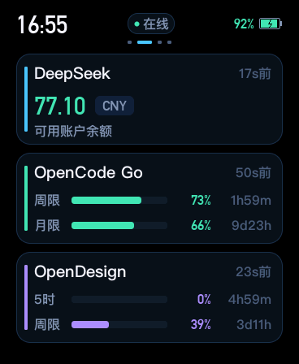
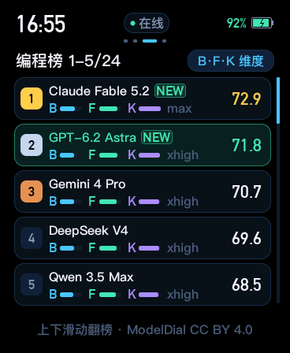

# 鲸鱼娘桌面宠物 · Nova Buddy（ESP32-S3 AMOLED）

基于 **Waveshare ESP32-S3-Touch-AMOLED-1.8（368×448）** 打造的桌面 AI 副屏玩具与智能监控伴侣（支持 DeepSeek Harness / Claude Cowork 工作流状态同步、算力订阅额度监控、ModelDial 编码模型排行榜、工具审批确认与桌面宠物互动）。

<p align="center">
  
  
  
  
</p>

## 核心特性

- **原生 `368×448` AMOLED · 60fps 局部脏矩形渲染**：主屏 Nova 鲸鱼娘 `NVA2` 96 色高清帧动画（162px 统一等比、纯黑抗锯齿融合与 XOR 帧间压缩）通过 PSRAM 解码与内部 SRAM 分带 DMA 局部刷新，实测稳定跑满 **60 fps**；全屏滑动切页采用 `180ms` PSRAM 双缓存平滑 `easeOutCubic` 合成。
- **LVGL 风格 `4-bpp` 抗锯齿字体与 AA 几何图元**：`PingFang SC`（覆盖 ASCII + GB2312 一级 3,755 常用字与 UI/宠萌补充字符，共 3,902 字形）+ `DIN Alternate Bold` 数字仪表字体，配合亚像素抗锯齿圆角卡片、顶部胶囊、圆点与进度条。
- **四屏循环交互 + 审批模态弹窗**：
  - **宠物主屏**：运行/等待/会话统计、上下文占比、`st.msg` 实时工具/异常状态提示，支持轻触 Nova 互动粒子与醒来反馈、空白处点按跑动与自动编排剧本。
  - **订阅额度**：DeepSeek 账户余额（CNY）、OpenCode Go 与 OpenDesign 周期额度条，本地实时递增数据年龄与重置倒计时，轻触卡片可立即触发宿主同步。
  - **ModelDial 榜单**：同步 24 款主流编码模型，支持**触摸实时上下滑动**与点击右上角切换 **`B·F·K 维度`** / **`审美·耗时`**。
  - **详情与偏好设置（基础 / 进阶双页）**：支持默认主页、功耗档位（自适应 / 长续航 / 灵动）、5 档音量（静音~100%）与 5 档亮度、TTS 语音播报开关、夜间静音（23–08 点）开关、电池自动息屏时长（15s~2m）、AI 编排开关、语音试听与 AP 重新配网。
- **WiFiManager 配网 + MQTT 双向桥接**：内置 Captive Portal 配网与自定义 Broker IP/端口；配套 `host-plugin/` DSH 插件负责多会话优先汇总、配额抓取、设备偏好联动与一键测试推送。

## 项目结构

```text
.
├── src/
│   ├── main.cpp           # UI 主循环、180ms 滑屏合成、串口截图命令
│   ├── anim/              # .nva 帧动画解码与 PSRAM 调度
│   ├── audio/             # ES8311 提示音合成
│   ├── boards/            # Waveshare ESP32-S3-Touch-AMOLED-1.8 引脚与屏参
│   ├── hw/                # QSPI 显示、I2C 总线任务、FT3168 触摸、AXP2101 电源、PCF85063 RTC、QMI8658 IMU
│   ├── model/             # NVS 设置与线程安全全局状态
│   ├── net/               # WiFiManager 配网、MQTT 客户端与 JSON 协议
│   └── ui/                # 4-bpp 字体引擎、AA 主题组件、6 页 UI 与导航
├── host-plugin/           # DeepSeek Harness (DSH) MQTT 桥接与额度/榜单抓取插件
├── deploy/mosquitto/      # Eclipse Mosquitto 2.0 Docker Compose 配置示例
├── tools/
│   ├── assets/            # .nva 动画转换工具
│   ├── fonts/             # 4-bpp 字体生成脚本 (gen_aafonts.py)
│   ├── sim/               # Mac 本机 Clang PNG 模拟器（零硬件快速预览 6 页）
│   ├── pio.sh             # PlatformIO 构建封装脚本
│   ├── prep_data.sh       # LittleFS .nva 资产打包脚本
│   └── usb_shot.py        # 通过 USB CDC (NVSH) 抓取开发板实时屏幕截图
└── docs/
    └── NOVA-BUDDY-PLAN.md # 完整架构设计方案与协议文档
```

## 快速开始

### 1. 本机 UI 模拟器（无需开发板）

```bash
./tools/sim/run.sh
# 输出 tools/sim/out/page_{home,quota,rank,detail,settings,settings_adv,approval}.png
```

### 2. 编译与烧录固件 & LittleFS 资源

```bash
# 打包 .nva 资源并上传 LittleFS
./tools/prep_data.sh
./tools/pio.sh run -e waveshare-esp32s3-touch-amoled-1-8 -t uploadfs --upload-port /dev/cu.usbmodemXXXX

# 编译并烧录固件
./tools/pio.sh run -e waveshare-esp32s3-touch-amoled-1-8 -t upload --upload-port /dev/cu.usbmodemXXXX
```

### 3. 启动 MQTT Broker 与 Host 端插件

```bash
# 部署 Mosquitto
docker compose -f deploy/mosquitto/docker-compose.yml up -d

# 安装主机插件并推送实时测试数据
cd host-plugin
npm install
node bin/nova-buddy.js test-push --id <你的6位设备ID>
```

---

## 致谢与借鉴署名（Credits & Attribution）

本项目站在社区开源工作之上构建，特此向以下项目与作者致谢：

1. **[vthinkxie/claude-desktop-buddy-esp32](https://github.com/vthinkxie/claude-desktop-buddy-esp32)**（基于 [anthropics/claude-desktop-buddy](https://github.com/anthropics/claude-desktop-buddy) 移植）
   - 借鉴并继承了 Waveshare ESP32 AMOLED 系列板的硬件 HAL 驱动框架（SH8601 QSPI、FT3168、AXP2101、QMI8658、PCF85063、ES8311、TCA9554）与板级引脚抽象。
2. **[JAYcodr/dsh-modeldial-leaderboard](https://github.com/JAYcodr/dsh-modeldial-leaderboard)** 与 **[ModelDial](https://modeldial.com/)**（榜单数据协议：`CC BY 4.0`）
   - 借鉴并整合了其 ModelDial 编码模型排行榜 HTML 解析器（综合分、后端、前端、知识、审美、可维护性、耗时与花费等完整维度）。
3. **[PC2005-cloud/dsh-pet](https://github.com/PC2005-cloud/dsh-pet)**
   - 借鉴了其一次播放播完推进（`onended` / 周期门控）、触碰 Q 弹挤压曲线（`squashScale`）、`leadSec` 起脚与 `tailSec` 收脚平缓减速、`noMirror` 镜像规则、点击音效防抖节流与独立气泡计时等桌宠交互细节。
4. **[kallen-noelle/aipets](https://github.com/kallen-noelle/aipets)**
   - 借鉴了其 LLM 行为导演提示词上下文（`recentClips` 近期动作记忆与动作库语义描述）、相邻/首尾动作防重复选择器（`ClipSelector`）及互动暂停/恢复逻辑。
5. **[78/xiaozhi-esp32](https://github.com/78/xiaozhi-esp32)**
   - 参考了其 ESP32-S3 Wi-Fi `WIFI_PS_MAX_MODEM` + `listen_interval=10` 低功耗策略及音频交互经验。
6. **核心开源库与社区方案**
   - [moononournation/Arduino_GFX](https://github.com/moononournation/Arduino_GFX)（`GFX Library for Arduino @ 1.6.9`，含 Waveshare SH8601 窄窗口补丁）
   - [LVGL](https://github.com/lvgl/lvgl)（参考了其 `4-bpp` 16 级 Alpha 抗锯齿字体渲染格式思路）
   - [tzapu/WiFiManager](https://github.com/tzapu/WiFiManager)、[256dpi/arduino-mqtt](https://github.com/256dpi/arduino-mqtt)、[bblanchon/ArduinoJson](https://github.com/bblanchon/ArduinoJson)、[lewisxhe/XPowersLib](https://github.com/lewisxhe/XPowersLib)、[lewisxhe/SensorLib](https://github.com/lewisxhe/SensorLib)

## 开源许可

保留原基线仓库 [LICENSE](LICENSE) 许可条款；ModelDial 排行榜数据遵循 `CC BY 4.0` 署名要求。
