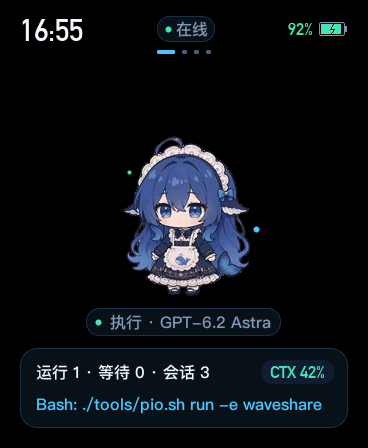
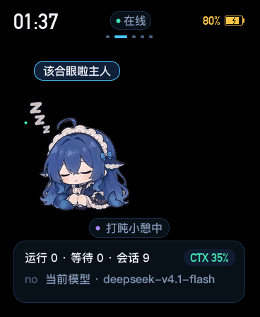
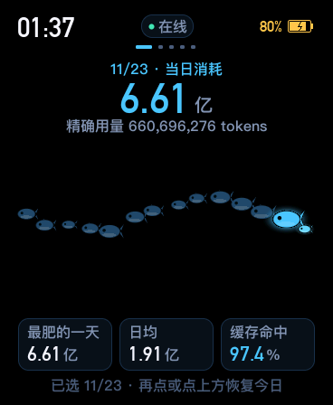
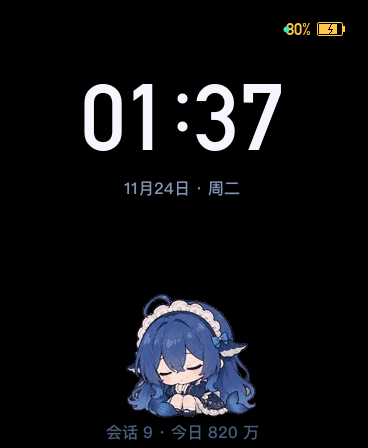
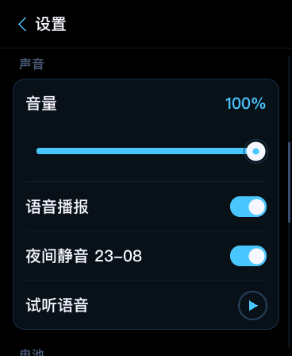
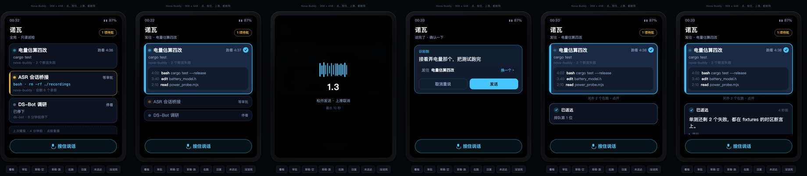

# 鲸鱼娘桌面宠物 · Nova Buddy

> **你桌上那块 1.8 寸小屏里，住着一只替你盯梢 AI、顺便吃掉几个亿 Token 的鲸鱼娘小女仆。**

她叫 **诺瓦（Nova）**，跑在一块 **Waveshare ESP32-S3 AMOLED 触控屏** 上。

但她**不是**那种“往外壳里塞个弱智对话模型”的玩具，而是你在电脑上跑 **DeepSeek Harness（DSH）** 时的**桌面外挂副屏 + 摸鱼搭子 + 无线对讲机**：

- **你在电脑前肝代码时**：她在旁边悠闲散步、打盹、把今天烧掉的几个亿 Token 画成一群游来游去的小鲸鱼；哪几个 Agent 正在干活、哪位卡在终端前等你点同意，扫一眼屏幕就知道。
- **你离开键盘去倒水、躺床上时**：按住屏幕底部的「按住说话」，就能直接往电脑里**正在跑的那个会话**里喊话——不是旁边随便敷衍你的小模型，回复还会压成一句话，用元气小女仆的声音念给你听。

<p align="center">
  
  
  
  
</p>

---

## 日常和她怎么玩

### 1. 一只真的会陪你摸鱼（也会催你睡觉）的小鲸鱼

平时不用管她，她自己就会在 `368×448` 的黑底屏幕上四处溜达：

- **戳戳乐**：点一下她，她会 Q 弹地压扁再回弹，头顶冒出一圈金蓝小星星，跟你撒娇说「在呢主人!」「摸摸头~」；要是她正缩着打盹，你手贱戳醒她，她会迷迷糊糊揉眼睛：「唔...醒啦，主人好!」。
- **指哪跑哪**：点舞台上的空白处，她会喊着「跑过来啦~」小跑着凑到你手指边上；点一下状态胶囊，还能手动切她的招牌动作。
- **背后还有个 AI 导演**：你不理她的时候，宿主端会每 15 分钟悄悄给她编一段 5 步摸鱼小剧本——散步、伸懒腰、偷看余额、委屈叹气，深夜还会换上睡衣台词劝你「该合眼啦主人」。
- **熄屏也能继续值班（AOD）**：插着电闲下来 2 分钟，屏幕会自动切进大号电子钟模式，诺瓦抱膝缩在表盘底下睡觉；就算这时电脑后台还有长任务在跑，她睡着了也会在最底下一行替你盯着（`运行 N · 会话 M · 今日 …`），一碰即醒。

<p align="center">
  
  
</p>

### 2. 离开电脑也不掉线：像对讲机一样直接插话进会话

有时候 AI 跑着跑着你离开工位了，懒得切回电脑敲键盘，直接按住看板底部的 **「按住说话」**：

1. **按住开麦，反悔上滑**：屏幕变暗、声波跟着你的声音跳；讲到一半发现说瓢了，手指直接往上一滑松开就作废。
2. **绝不替你社死**：松手后先出一张「识别到」确认卡片——**没有倒计时自动发送**！确认字没认错、下面投递的会话名也对得上，再亲手点「发送」（也可以当场切到另一个会话）。
3. **撞上正在干活的窗口会问你**：目标窗口如果刚好在跑任务，按钮会变成「排队 / 打断」，由你拍板要不要直接插队。
4. **电报式一句话回执**：话送进电脑真实的会话里后（电脑窗口会多出一条带设备编号的消息），等它跑完，小屏的同一张卡会一路变身 `已送达` → `在跑 · N 秒` → 压缩到 **40 个字宽以内**的干货结论，并用小米 MiMo TTS（默认「冰糖」声线）直接读给你听。夜里 `23:00–08:00` 懂事自动静音，不怕半夜外放吓一跳。

<p align="center">
  
</p>

> 💡 想提前用鼠标白嫖手感？可以直接在浏览器里离线打开 [docs/design/voice-bridge-final.html](docs/design/voice-bridge-final.html)，它是 1:1 的 `368×448` 可交互原型，点得动也能按住。

### 3. 把几个亿 Token 变成一群一起游的小鲸鱼

谁喜欢看干巴巴的折线图？我们把过去半个月每天的 Token 消耗画成了**一群游向右侧的发光小鲸鱼**——哪天烧得最猛，那条鲸鱼就最肥，点一下还能看当天的精确账单（「最肥的一天 6.61 亿 / 缓存命中 97.4%」）。

再往右滑，还能随时瞄一眼你的钱包和模型风向标：

- **订阅额度**：DeepSeek 账户还剩多少钱（CNY）、OpenCode Go 和 OpenDesign 周期额度用了多少、还有多久重置，点一下卡片立刻刷新。
- **ModelDial 编程榜**：直接把 24 款主流编码模型装进口袋里，手指上下翻榜，点右上角还能在 `B·F·K 维度` 和 `审美·耗时` 之间来回切着看。

<p align="center">
  
  
</p>

### 4. 关键时刻替你踩刹车的小门卫

Agent 突然想执行 `rm -rf` 或者敏感工具时，无论你当前停在哪个页面，屏幕都会立刻弹出一张琥珀/红框审批弹窗——不仅给你看命令原文，还会先帮你翻译成一句人话（比如「`会删 6 个录音`」）。

点「批准执行」放行，点「拒绝」拦下，**20 秒没人理它自动帮你拒掉**，绝对不让模型在桌面无人看守时放飞自我。

### 5. 六张屏闭环滑动 + 一页搞定的设置

左右滑动就是一个完整循环：**鲸鱼 Token → 诺瓦主屏 → 订阅额度 → 编程榜单 → 设备心跳 → 语音看板**。

点左上角或按一下实体键 Key1 进设置，没有套娃子菜单，6 组 16 行一页排开：亮度、音量直接上手拖滑块即时生效；像「重新配网」「恢复出厂」这种危险按钮，必须 3 秒内连点两次才作数，专门防手滑。

---

## 给折腾党：底子有多硬核

虽然表面看起来很摸鱼，但为了在这颗 **ESP32-S3 + 1.8 寸 AMOLED** 上做到丝滑跟手，底下其实抠了不少细节：

- **满血 60fps 局部脏矩形 + 双缓存滑屏**：自研 `NVA2` 96 色帧动画（纯黑抗锯齿融合 + XOR 帧间压缩），PSRAM 解码配合内部 SRAM 分带 DMA 局部刷新，稳定跑满 **60 fps**；页面左右滑动采用 `180ms` PSRAM 双缓存 `easeOutCubic` 合成，全套缓动体系收在 `src/ui/easing.h`。
- **专门定制的 `4-bpp` 抗锯齿字体**：内嵌 `PingFang SC`（覆盖 ASCII + GB2312 一级 3,755 常用字及宠萌符号，共 3,902 字形）和 `DIN Alternate Bold` 仪表大数字，配合亚像素抗锯齿圆角与图元，贴近看也没有毛刺。
- **省电不装死**：插电活跃时 UI 忙率 ~52%（240MHz），进入 AOD 熄屏时钟后直降到每分钟仅 5 次刷新、UI 忙率 **~2%**（80MHz），还有防烧屏周期微漂移。
- **认真的电量估算与热保护充电**：补齐 AXP2101 针对 600mAh 小电池的充电参数与「亮屏 300mA / 熄屏 500mA」动态限流（PMU 到 49°C / 53°C / 59°C 自动降流/停充）；电量不再傻傻按线性电压换算，而是结合 **OCV 曲线 + 充电阶段机 + 满空锚点 + 单调平滑**，彻底治好“插上电几分钟虚涨 50%”的幻觉。
- **零侵入宿主桥接**：`host-plugin/` 基于 MQTT 双向通信，Token 统计直读压缩会话日志（`ctx.sessions` 拿不到历史），语音压缩走独立的一次性小模型调用，**绝不修改工作会话本身的 prompt 或挂载多余工具**。

<details>
<summary>📂 展开查看仓库目录结构</summary>

```text
.
├── src/
│   ├── main.cpp           # UI 主循环、180ms 滑屏合成、串口截图命令
│   ├── anim/              # .nva 帧动画解码与 PSRAM 调度
│   ├── audio/             # ES8311 提示音与 ADPCM 播放
│   ├── boards/            # Waveshare ESP32-S3-Touch-AMOLED-1.8 引脚与屏参
│   ├── hw/                # QSPI 显示、I2C 总线任务、FT3168 触摸、AXP2101 电源、PCF85063 RTC、QMI8658 IMU
│   ├── model/             # NVS 设置、线程安全全局状态、电量估计（battery_model.h）、AOD 策略（aod_policy.h）
│   ├── net/               # WiFiManager Captive Portal 配网、MQTT 客户端与 JSON 协议
│   └── ui/                # 4-bpp 字体引擎、AA 主题组件、7 页 UI 与导航（page_chat.cpp = 语音看板）
├── host-plugin/           # DSH MQTT 桥接插件：会话注入（bridge.js）、ASR（asr.js）、编排与压缩（ai.js）、ADPCM（adpcm.js）
├── deploy/mosquitto/      # Eclipse Mosquitto 2.0 Docker Compose 配置示例
├── tools/
│   ├── assets/            # .nva 动画转换工具
│   ├── fonts/             # 4-bpp 字体生成脚本 (gen_aafonts.py)
│   ├── sim/               # Mac 本机 Clang PNG 模拟器（没有开发板也能一键出全页渲染图）
│   ├── icons/             # 图标 SVG 与 gen_icons.py（生成 src/ui/icons_data.cpp）
│   ├── asr_probe.mjs      # 用本地 wav 对拍 ASR 识别结果与耗时
│   ├── rec_receiver.mjs   # 本地收麦克风分片存 WAV，查峰值/底噪/削波
│   ├── power_probe.mjs    # 在线设备功耗与渲染帧率采样
│   ├── pio.sh             # PlatformIO 构建封装脚本
│   ├── prep_data.sh       # LittleFS .nva 资产打包脚本
│   └── usb_shot.py        # 通过 USB CDC (NVSH) 抓取开发板实时屏幕截图
├── HANDOFF.md             # 交接备忘
└── docs/
    ├── design/            # 语音交互原型（voice-bridge-final.html）、设计稿与评审记录
    ├── previews/          # 模拟器与真机截图存档
    ├── ARCHITECTURE.md    # 架构参考
    ├── NOVA-BUDDY-PLAN.md # 完整架构设计方案与协议文档
    └── upstream/          # fork 前基线文档（已废弃）
```

</details>

---

## 快速上手

### 1. 没买开发板？先在电脑上跑一遍看看

Mac 上内置了一个零硬件的 Clang UI 模拟器，能把所有界面和单测直接跑通：

```bash
# 一键把所有页面渲染成 PNG 到 tools/sim/out/
./tools/sim/run.sh

# 跑电量估计 / 充电策略纯逻辑单测
bash tools/test_battery.sh

# 跑 AOD 熄屏策略纯逻辑单测
bash tools/test_aod.sh

# 一条命令跑完所有回归（含上面两项 + 协议 / 设置 / 宿主单测 / 47 张像素基线）
bash tools/check_all.sh

# 设备在线且 broker 可达时，采样实机功耗与帧率
node tools/power_probe.mjs --id D93468 --minutes 20 --tag aod-off
```

### 2. 给开发板打包资源并烧录固件

```bash
# 第一步：打包 .nva 动画等资源并上传 LittleFS 分区
./tools/prep_data.sh
./tools/pio.sh run -e waveshare-esp32s3-touch-amoled-1-8 -t uploadfs --upload-port /dev/cu.usbmodemXXXX

# 第二步：编译并烧录固件
./tools/pio.sh run -e waveshare-esp32s3-touch-amoled-1-8 -t upload --upload-port /dev/cu.usbmodemXXXX
```

烧完开机连上设备自建热点即可配网，并填写你的 MQTT Broker 地址与端口。

### 3. 打开语音对讲与编排（按需配置 Key）

语音和剧本能力由下面三条独立链路撑起来，**缺哪条就少哪项能力，不会偷偷静默降级**：

| 你想要的能力 | 怎么配 | 为什么选它 / 备注 |
|---|---|---|
| **按住说话识别（ASR）** | 环境变量 `XIAOMI_API_KEY` | 走小米 MiMo `mimo-v2.5-asr`，实测比常规 ASR 更能扛桌面低音量录音 |
| **回复读给你听（TTS）** | `MIMO_API_KEY`，或 `~/.dsh/nova-buddy/config.json` 里的 `tts.apiKey` | 走 MiMo TTS，默认元气音色「冰糖」，也支持声纹克隆 |
| **长回复压成一句话** | `~/.dsh/nova-buddy/config.json` 里的 `llm.primary` / `llm.fallback` | 顺带也负责给诺瓦编摸鱼小剧本；只在回复超过 40 字宽时触发一次 |

### 4. 拉起 MQTT Broker 与主机插件

```bash
# 启动 Mosquitto MQTT Broker
docker compose -f deploy/mosquitto/docker-compose.yml up -d

# 安装 DSH 主机插件，给小屏推一包实时测试数据
cd host-plugin
npm install
node bin/nova-buddy.js test-push --id <你的6位设备ID>
```

---

## 致谢与灵感来源（Credits & Attribution）

这个小东西站在很多优秀的开源项目肩膀上长大，特此向以下项目与作者致谢：

1. **[vthinkxie/claude-desktop-buddy-esp32](https://github.com/vthinkxie/claude-desktop-buddy-esp32)**（基于 [anthropics/claude-desktop-buddy](https://github.com/anthropics/claude-desktop-buddy) 移植）
   - 借鉴并继承了 Waveshare ESP32 AMOLED 系列板的硬件 HAL 驱动框架（SH8601 QSPI、FT3168、AXP2101、QMI8658、PCF85063、ES8311、TCA9554）与板级引脚抽象。
2. **[JAYcodr/dsh-modeldial-leaderboard](https://github.com/JAYcodr/dsh-modeldial-leaderboard)** 与 **[ModelDial](https://modeldial.com/)**（榜单数据协议：`CC BY 4.0`）
   - 借鉴并整合了其 ModelDial 编码模型排行榜 HTML 解析器（综合分、后端、前端、知识、审美、可维护性、耗时与花费等完整维度）。
3. **[PC2005-cloud/dsh-pet](https://github.com/PC2005-cloud/dsh-pet)** —— 角色素材与桌宠灵魂交互
   - **角色素材（鲸鱼娘 / Nova）**：形象取自 dsh-pet，许可是 [`CC BY-NC-SA 4.0`](https://creativecommons.org/licenses/by-nc-sa/4.0/deed.zh-hans)（署名 · 非商业 · 相同方式共享）。原型「溟月」出自 B 站 [@上善无形](https://space.bilibili.com/4456176)，DeepSeek 女仆款出自 [@ZipZipPipe](https://space.bilibili.com/4168597)；出处与授权见 [dsh-pet 许可节](https://github.com/PC2005-cloud/dsh-pet#许可) 与 [形象声明](https://www.bilibili.com/opus/1247156596114456581)。
   - **交互细节**：借鉴了一次播放播完推进（`onended` / 周期门控）、触碰 Q 弹挤压曲线（`squashScale`）、`leadSec` 起脚与 `tailSec` 收脚平缓减速、`noMirror` 镜像规则、点击音效防抖节流与独立气泡计时等。
4. **[kallen-noelle/aipets](https://github.com/kallen-noelle/aipets)**
   - 借鉴了其 LLM 行为导演提示词上下文（`recentClips` 近期动作记忆与动作库语义描述）、相邻/首尾动作防重复选择器（`ClipSelector`）及互动暂停/恢复逻辑。
5. **[78/xiaozhi-esp32](https://github.com/78/xiaozhi-esp32)**
   - 参考了其 ESP32-S3 Wi-Fi `WIFI_PS_MAX_MODEM` + `listen_interval=10` 低功耗策略及音频交互经验。
6. **核心开源库与社区方案**
   - [moononournation/Arduino_GFX](https://github.com/moononournation/Arduino_GFX)（`GFX Library for Arduino @ 1.6.9`，含 Waveshare SH8601 窄窗口补丁）
   - [LVGL](https://github.com/lvgl/lvgl)（参考了其 `4-bpp` 16 级 Alpha 抗锯齿字体渲染格式思路）
   - [tzapu/WiFiManager](https://github.com/tzapu/WiFiManager)、[256dpi/arduino-mqtt](https://github.com/256dpi/arduino-mqtt)、[bblanchon/ArduinoJson](https://github.com/bblanchon/ArduinoJson)、[lewisxhe/XPowersLib](https://github.com/lewisxhe/XPowersLib)、[lewisxhe/SensorLib](https://github.com/lewisxhe/SensorLib)

## 开源许可

代码部分保留原基线仓库 [LICENSE](LICENSE) 许可条款。

- **ModelDial 排行榜数据**：遵循 `CC BY 4.0` 署名要求。
- **角色素材（鲸鱼娘 / Nova，含 `assets/pets/nova/`、`data/pets/nova/` 与全部形象衍生资产）**：来自 [PC2005-cloud/dsh-pet](https://github.com/PC2005-cloud/dsh-pet)，单独适用 [`CC BY-NC-SA 4.0`](https://creativecommons.org/licenses/by-nc-sa/4.0/deed.zh-hans)（署名 · 非商业 · 相同方式共享），与代码许可分开：**本项目及基于本项目的衍生作品不得用于商业用途**，再分发时须保留上方署名并以相同协议共享。
