# Nova Buddy — 架构参考（AI 改动入口）

> **同步**：2026-11-26 · 分支 `main` · 固件 `0.6.0` · 插件 `0.3.0`
> **读者**：AI 与改动者。只回答三件事：**代码在哪、契约是什么、改一处会碰坏什么**。需求与取舍在 [NOVA-BUDDY-PLAN.md](NOVA-BUDDY-PLAN.md)。
> **维护**：契约变了先改 §3 再改代码；新增模块/任务/主题同步 §2/§7/§8；图里不许出现代码已删除的名字。
> **图**：[docs/diagrams/](diagrams/) 是下列 mermaid 的 PNG 导出；两者冲突以本文件为准。
> **入口**：[AGENTS.md](../AGENTS.md)（文档地图、常用命令、提交约定）。

---

## 0. 速览

| 项 | 内容 |
|---|---|
| 形态 | 桌面副屏 + 桌面宠物：Mac 侧算事实（凭据、会话、出网），ESP32 侧管感觉（像素、动画、声音） |
| 设备 | Waveshare ESP32-S3-Touch-AMOLED-1.8：368×448 SH8601 QSPI、FT3168 触摸、AXP2101 电源、PCF85063 RTC、QMI8658 IMU、ES8311 音频 |
| 固件 | Arduino / PlatformIO，`env:waveshare-esp32s3-touch-amoled-1-8`；全局 `-O2`；1.8" 16MB 无 OTA（`no_ota_16mb.csv`，spiffs 12MB；其余板仍 8MB）；`.nva` 动画在 LittleFS |
| 宿主 | DSH 插件 `host-plugin/`：`dsh-plugin-nova-buddy@0.3.0`，ESM，运行依赖只有 `mqtt` |
| 链路 | WiFi + MQTT（局域网匿名 broker）；主题 `nova/<deviceId>/…`；QoS1；retain 按主题；LWT 发 `hello {online:false}` |
| 七页 | HOME 宠物 / QUOTA 额度 / RANK 榜单 / DETAIL 心跳 / SETTINGS 设置 / TOKENS 鲸鱼 / CHAT 语音看板 |

### 0.1 代码地图（宿主 / 工具；固件模块见 §2.1）

| 路径 | 职责 | 改动注意 |
|---|---|---|
| `host-plugin/index.js` | cordis 入口：inject `tokenMeter`、3 个 global 监听、装配 bridge | 见 §6-4 |
| `host-plugin/lib/bridge.js` | 会话聚合、state/sessions 节流发布、审批仲裁、chat 投递、定时器 | 最大模块，改动风险最高 |
| `host-plugin/lib/fetchers.js` | 余额 / OpenCode / OpenDesign / ModelDial 抓取与磁盘缓存 | 失败域独立 |
| `host-plugin/lib/tokens.js` | 会话日志 → 按日 token 聚合 | 见 §6-5 |
| `host-plugin/lib/ai.js` · `adpcm.js` | LLM 剧本 / 摘要 / TTS，WAV → NVAD ADPCM | 主备两路、15–25s 超时 |
| `host-plugin/lib/asr.js` | mic 分片重组 + MiMo ASR | 60s 过期淘汰 |
| `host-plugin/lib/power.js` | 电源事件日志、续航/充电估算 | 只写 `~/.dsh/nova-buddy/` |
| `host-plugin/bin/nova-buddy.js` | CLI：`auth opendesign`、`test-push`、`test-choreo`、`test-tts`、`power` | — |
| `tools/sim/` | Mac 模拟器：同一套 `ui/` 源码，`-DNOVA_HOST_SIM`，输出 PNG | 像素基线 51 项（49 页 + 2 项局部重绘） |
| `tools/` | `check_all.sh` 总回归、`power_probe.mjs`、`asr_probe.mjs`、`rec_receiver.mjs`、`usb_shot.py`、`verify_state_payload.mjs`、`pio.sh` | 见 §9 |
| `assets/pets/nova/` → `data/pets/nova/` | 24 个 `.nva` 动画包（10.4MB，spiffs 分区 12MB）；`tools/prep_data.sh` 打成 LittleFS 镜像 | 改动画名要同步 `nva.h` 枚举与 `page_home` 用法 |
| `assets/audio/` → `data/audio/` | 17 条 `.adp` 语音（392KB）：boot / run / tap0-2 + 12 条点击·唤醒变体；`node tools/assets/gen_voice.mjs` 用本机听书值守（本地 Qwen3-TTS）重生成 | 响度锁 RMS≈-20dB、峰值≤-7dB（小喇叭会破）；改文本要同时改 `page_home.cpp` 的台词表 |
| `deploy/mosquitto/` | broker 的 docker-compose 与配置 | — |
| `attic/` | 硬件点屏验证页，不参与编译 | — |

### 0.2 配置与凭据

| 项 | 位置 | 说明 |
|---|---|---|
| broker | 插件配置 `brokerUrl` → 环境 `NOVA_MQTT_URL` → 默认 `mqtt://192.168.31.15:1883` | 设备侧另存 NVS `brokerHost/brokerPort`（配网页写） |
| 插件配置 | profile 插件条目：`deviceApproval`、`fallbackMs`、`ttsVoice`、`ttsStyle`、`quietHours`、`choreoIntervalMs`、`tokens`、`powerLog` | `index.js` 原样传给 bridge |
| LLM / TTS | `~/.dsh/nova-buddy/config.json`：`llm.primary/fallback{name,url,apiKey,model,maxTokens,reasoningEffort}`、`tts{url,apiKey,model,voice,voiceRef,style,quietHours}` | 剧本、摘要、TTS 共用 |
| ASR key | 环境 `XIAOMI_API_KEY` → `~/.dsh/.credentials.yaml` 同名 → `config.tts.apiKey` | `asr.js:loadMiMoApiKey` |
| 抓取凭据 | DeepSeek key：环境 `DEEPSEEK_API_KEY` → `~/.dsh/nova-buddy/deepseek.key` → `~/.dsh/.credentials.yaml`；OpenCode 读 `~/.local/share/opencode/auth.json`；OpenDesign cookie 存 `~/.dsh/nova-buddy/opendesign.cookie`（600） | 401/403 → 该卡 `kind:'na'`，其余照常 |
| 宿主缓存 | `~/.dsh/nova-buddy/`：`cache.json`、`tokens-cache.json`、`power-events.jsonl`、`power-summary.json`、`deepseek.key` | 缓存可删自动重建；key 文件别删 |
| 设备设置 | NVS，键表 `src/model/settings.h:kSettings`（home/pwr/snd/brt/tts/quiet/choreo/sleep_s/chg_lim/chg_spd/aod/aod_idle/aod_night/mic_gain） | 键名逐字固定；`toHost` 的项同时是 `prefs` 的 JSON 键 |
| 编译开关 | 1.8 env：`-O2`、`-fno-math-errno`、`ESP32QSPI_MAX_PIXELS_AT_ONCE=8192`、可选 `NOVA_SLIDE_EASE_QUART` | 去掉 `-fno-math-errno` 鲸群每像素走 libm，+30ms/帧 |

---

## 1. 分层与数据流

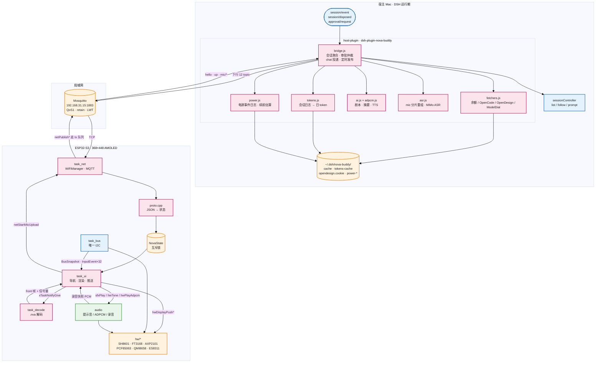

**图注**：跨界只有 MQTT 一条路。设备不碰密钥与公网，Mac 不碰像素；`proto.cpp` 是下行数据变状态的唯一落点。

---

## 2. 设备端：模块、任务与同步

### 2.1 模块与依赖

| 模块 | 职责 | 直接依赖 | 边界 |
|---|---|---|---|
| `main.cpp` | task_ui：串口命令、输入分发、UiAction 执行、页面调度、脏矩形、帧率/DFS、AOD、录音上传状态机 | nav · pages · nva · sfx · net · state · settings · display · transition | 只有它能碰 canvas |
| `ui/nav.cpp` | 页面环、滑动、绘制分发 | pages · state | 页面只画不改状态 |
| `ui/page_*.cpp` | 七页绘制 / 点按 / 滚动惯性 | theme · icons · nva · state · settings | 点按返回 `UiAction`，逻辑回 main |
| `ui/transition.cpp` | 180ms 双缓存滑屏合成 | display · canvas · easing | 只在切页时 |
| `ui/theme.cpp` · `aafont_data.cpp` | 色板、组件、4-bpp 字体 | — | 字体 6.7MB，不进逻辑 |
| `anim/nva.cpp` | `.nva`（NVA2）解析、zlib、XOR 帧差、双缓冲、`task_decode`；24 动作，常驻 IDLE/SUCCESS/ERROR 3 槽，其余走共享流式槽 `s_streamPack` | theme | 解码只写后缓冲；单帧 `w*h ≤ 220×224` |
| `audio/sfx.cpp` | 提示音序列 | hw/audio | — |
| `hw/bus.cpp` | I2C 唯一主：触摸 / 电量 / RTC / IMU / 扩展 IO / 麦克风增益 | power · rtc · imu · input · expander · audio | 任何 I2C 都走它 |
| `hw/display.cpp` | QSPI 推送（全屏 / 矩形 / 亮度） | expander · power | 约束见 §5 |
| `hw/audio.cpp` | ES8311 播放与录音、I2S | pins · ES8311 | 增益写寄存器只走 bus |
| `hw/power.cpp` | AXP2101、充电策略、电源事件 | battery_model | 无 UI 依赖 |
| `net/net.cpp` | WiFiManager、MQTT 任务、发送队列、mic 上传 | proto · settings · state | 不写业务字段，只写连接态 |
| `net/proto.cpp` | JSON 编解码、`apply*`、`protoBuild*` | state · settings · rtc · audio · bus · battery_model · aod_policy | 下行唯一落点，持锁写 |
| `model/state.cpp` | 全局态 + 互斥锁 + 整份拷贝 | — | 见 §6-6 |
| `model/settings.cpp` | NVS 表驱动读写、迁移、`prefs` | log | 键名不可改 |
| `model/battery_model.h` · `aod_policy.h` | 电量/充电、AOD 纯策略 | 无 Arduino 依赖 | 主机单测直接编译 |

### 2.2 任务划分

| 任务 | 核 | 优先 | 栈 | 触发 | 独占资源 | 职责 |
|---|---|---|---|---|---|---|
| `task_ui` | 1 | 5 | 10240 | deadline 16.6ms（随目标帧率变） | **canvas / framebuffer** | 串口命令、输入事件、动作分发、七页绘制、脏矩形推送、动画状态机、DFS、熄屏/AOD |
| `task_bus` | 0 | 6 | 4096 | 20ms（4ms×5 切片，触摸 IRQ 可打断） | **I2C** | 触摸/按键/PEK、电池（每 50 tick）、RTC（每 10 tick）、IMU 翻面；写 `BusSnapshot`、投 `InputEvent` |
| `task_net` | 0 | 4 | 12288 | 25ms 轮询（配网 10ms） | **WiFi / MQTT 句柄** | 配网 portal、MQTT 连接与退避、订阅 12 topic、收包→`protoApplyMessage`、排空发送队列、30s 上报 stat、PS 档位、mic 分片上传 |
| `task_decode` | 1 | 3 | 8192 | `ulTaskNotifyTake` | **.nva 解码缓冲** | zlib 解压 + XOR 帧差 → 后缓冲，成功后切 front 指针 |
| `audio` | 无亲和 | 5 | 6144 | 队列（深 16） | **I2S / ES8311** | 提示音、ADPCM 播放、录音；`voiceGen` 代际号丢弃过期请求 |
| `loop()` | — | — | — | — | — | `vTaskDelay(portMAX_DELAY)`，主循环已全部搬进任务 |

### 2.3 跨任务同步（三选一，别混用）

| 机制 | 用于 | 规则 |
|---|---|---|
| 互斥锁 `novaStateWithLock` | `NovaState`（3KB+ 大结构） | 读写都整份拷贝；持锁期间不做 I2C / 推送 / 等队列 |
| `portMUX` 临界区 | `BusSnapshot`（POD） | 只拷 POD，极短，不放业务分支 |
| FreeRTOS 队列 / 通知 | `InputEvent`×32、音频队列、发送队列、解码通知 | 满了就丢并计数（`netPublishQueueDropCount` / `hwAudioQueueDropCount`），不回压 UI |

`task_ui` 与 `task_decode` 同在 Core 1 是有意的：解码优先级低，取不到新帧就重播上一帧，**解压不许阻塞渲染**。

### 2.4 `task_ui` 单帧

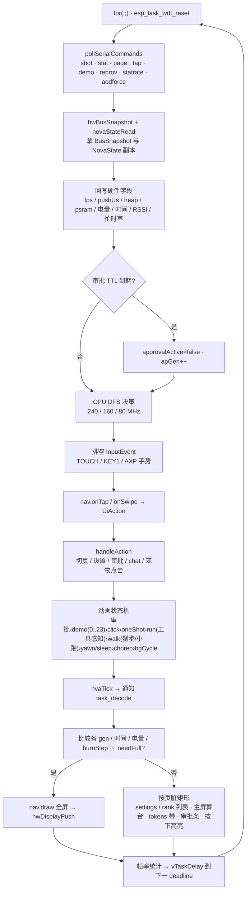

---

## 3. 协议（宿主 ↔ 设备）

### 3.1 主题总表

前缀 `nova/`，`<id>` = MAC 后 3 字节（例 `D93468`）。下行 12、上行 3 类。

| 主题 | 方向 | QoS | retain | 生产 → 消费 | 触发 |
|---|---|---|---|---|---|
| `state` | ↓ | 1 | ✅ | `buildStatePayload` → `applyState` | 会话事件；同内容 5s 不重发，最短 400ms |
| `sessions` | ↓ | 1 | ✅ | `buildSessionsPayload` → `applySessions` | 同 state，节流同 |
| `quota` | ↓ | 1 | ✅ | `fetchAllQuota` → `applyQuota` | 连接 / 5min / `sync` |
| `rank` | ↓ | 1 | ✅ | `fetchModelDialRank` → `applyRank` | 6h TTL / 强制刷新 |
| `tokens` | ↓ | 1 | ✅ | `tokenCollector` → `applyTokens` | 60s，内容不变不发 |
| `approval` | ↓ | 1 | ❌ | `onApprovalRequest` → `applyApproval` | 事件，**不许 retain** |
| `approval_end` | ↓ | 1 | ❌ | `settleApproval` → `applyApprovalEnd` | 已裁决 / 超时 |
| `time` | ↓ | 0 | ✅ | `pushTime` → `applyTime` | 30s 心跳 + hello |
| `choreo` | ↓ | 1 | ❌ | `generateChoreography` → `applyChoreo` | 15min + turn-end 120s 冷却 |
| `tts` | ↓ | 1 | ❌ | `publishTts` → `applyTtsChunk` | 事件，1800B/片 |
| `chat` | ↓ | 1 | ❌ | `bridge` → `applyChat` | 事件：`asr` / `delivery` / `reply` |
| `mic_ack` | ↓ | 1 | ❌ | `handleMicMessage` → `applyMicAck` | 每次录音 |
| `hello` | ↑ | 1 | ✅(LWT) | 设备 → `handleHello` | 连接时 / 断线 LWT |
| `up` | ↑ | 1 | ❌ | 设备 → `handleUp` | `decision` `stat` `prefs` `sync` `pwr` `chat_send` `chat_tts` |
| `mic/start` `mic/chunk` `mic/end` | ↑ | 1 | ❌ | 设备 → `handleMicMessage` | 每次录音；片 = 6B 头 + 2048B PCM |

### 3.2 载荷契约

| 主题 | 字段 | 约束 |
|---|---|---|
| `state` | `run` `wait` `sess` | 会话计数；主会话按 `waiting > running > error > idle` 选 |
| | `msg` | ≤112B 单行；**不许含「异常」**（设备拿它兜底判错） |
| | `err` | **只能是字面量 `true`**；`1`、`"true"`、对象都会被 ArduinoJson 的默认值运算符取成 0 |
| | `ctx.pct` | 0..100，`tokenMeter.contextPressure`，只在 turn/end、step/end 采样 |
| | `model` `title` `tool` `errMsg` | ≤32 / ≤40 / ≤24 / ≤136B，主屏码头用 |
| `sessions` | `items[≤4]` | 每项 `{id,name,cwd,st∈{run,wait,err,idle},el,act,note,steps[≤3]{t,s,a}}`；顶层 `lastSay` `lastAgo` |
| `approval` | `id` `tool` `reason` `ttl` | `reason`≤140；可选 `sess` `note`；`approval_end` 只要 `id` |
| `choreo` | `mood` `steps[≤6]` | 每步 `{x∈[80,288],speed:walk/run,anim,dur(ms),say}`；宿主收口 `mood≤20`、`say≤18` 字、`dur 10–24s`（设备兜底 1.5–30s）；`anim` 只认 24 枚举（清单见 §4.2），未知回落 `0=idle` |
| `tts` | `id` `seq` `tot` `b64` | 1800B ADPCM/片；设备上限 `98304B`，超了整条静默丢 |
| `chat` | `asr` | `{t,id,ok,text/err}` → 草稿卡 |
| | `delivery` | `{t,id,kind:sent/run/reply/fail/mute,pos,secs/ago,target,name,text}` |
| `mic_ack` | `id` `ok` `missing` `file` `err` | `missing`=缺片数；`ok=false` 直接进 ERR |
| `up` | `hello` | `{online,hello{id,fw,w,h,fps,ip,pwr,aod,onSrc,offSrc},prefs}` |
| | `stat` | `{fps,drop,heap,psram,mhz,rssi,mv,pct,chg,stage,tmp,drawFps,pushUs,idle,draws,pwr,brt,lcd,aod,tx,cpu{ui,dec}}` |
| | `pwr` | `{seq,why,pct,raw,gauge,st,mv,vb,vs,ma,tmp,usb,chg,mohm,…}`；`why`∈boot/usb_in/usb_out/stage/probe/therm/low_bat |
| | `decision` `chat_send` `chat_tts` | `{id,accept}` / `{id,toPc}`；`{id,text,target,mode:queue/steer}`；`{text}` |

> 设备上行 JSON 装 `NetTxMsg.payload[448]`；下行无此限制（MQTT 读缓冲 4096，TTS 片靠它才收得下）。

### 3.3 状态主链路

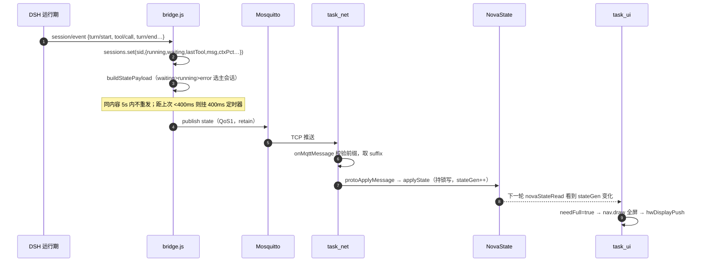

### 3.4 审批闭环

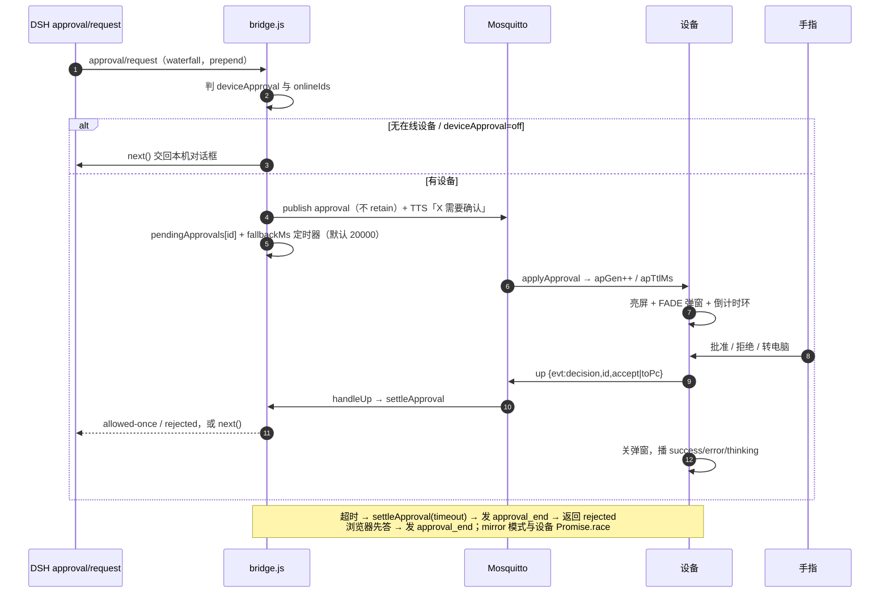

| 项 | 行为 |
|---|---|
| 模式 | `mirror`（默认，谁先答听谁的）/ `prefer`（只等设备）/ `off`（不接管） |
| 超时 | 两种模式都返回 `rejected`，**不再回退本机对话框** |
| 转电脑 | 只有设备点「转电脑」（`toPc`）才 `next()` |
| 重投 | 同 `id` 幂等：不重置 `apArrivedMs`、不 `apGen++` |

### 3.5 语音看板（按住说话 → 会话 → 回执）

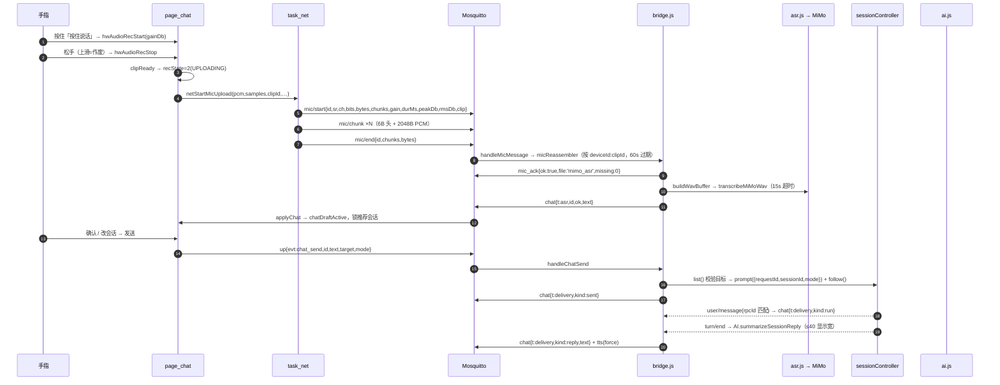

设备录音状态：`0 IDLE → 1 RECORDING → 2 UPLOADING → 3 SENT_WAIT_ACK → 4 SAVED`，异常 `5 ERR`；`3`/`4` 超 10s 无对应回执 → `5`（"回执超时"/"识别超时"）。

**投递规则**：目标 `waiting`（等审批）拒收回 `fail`；失效会话回 `fail`「请重选」；`queue` 排队、`steer` 打断；宿主 `pendingChatQueue` 上限 8 条、15s 过期。草稿必须锁真实会话（目标失效/等待审批时自动预选推荐会话）。

### 3.6 TTS 链路

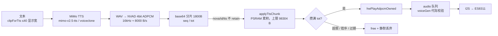

**两个上限**：① 单条 98304B ≈ 12s ≈ 43–55 汉字，超了整条丢弃**且无提示** → 所有 TTS 文本先 `clipForTts(≤40 显示宽)`；② `force:true` 跳过 4s 节流，必须配 `ttsDedupHit` 30s 去重。设备侧另有三道闸：`ttsEnabled`、`soundPct>0`、夜间静音（23–08）。

### 3.7 三条出网抓取支线

| 支线 | 触发 | 数据源 | 缓存 / 失败域 |
|---|---|---|---|
| 额度 `quota` | 连接、5min、`sync` | DeepSeek 余额（Bearer key，走 DSH credentialsService）、OpenCode `auth.json`、OpenDesign cookie×2 | `cache.json`；单源 401/403 → 该卡 `na`+`reauth`；超时用缓存 + `ageSec`；无 cookie → `no-session` |
| 榜单 `rank` | 6h TTL、强制刷新 | `modeldial.com/api/v1/radar/latest.json`，失败回退 HTML 解析 | `cache.json`，6h TTL |
| Token `tokens` | 60s | `$DSH_HOME/sessions/**/session*.jsonl.zstd` | `tokens-cache.json`；按 `mtimeMs+size` 增量，首扫全量 |

**token 页不走 `ctx.sessions`**：`list()` 只列当前进程 live session，拿不到历史。DSH 会话文件是逐条 append 的多帧 zstd 流，必须按 magic `28 B5 2F FD` 切帧逐帧解；口径与 tokenMeter 对齐（同 `(turn,step)` 后到替换，按事件 `time` 归日）。

### 3.8 宠物剧本

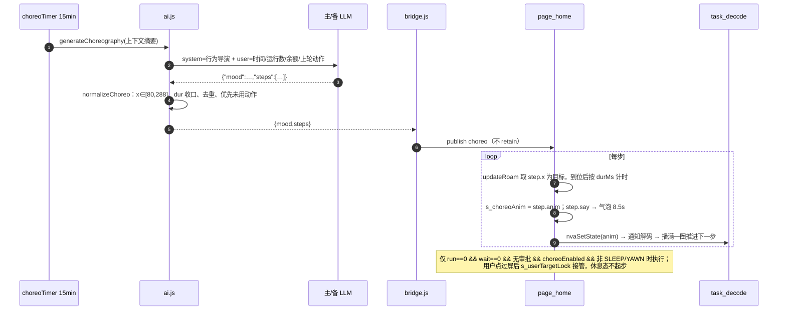

---

## 4. 页面、电源与在线

### 4.1 页面环

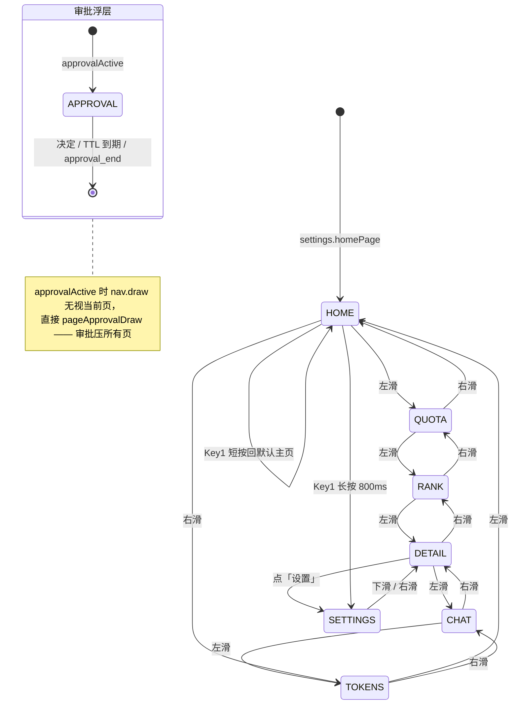

环序 `kPageRing = TOKENS → HOME → QUOTA → RANK → DETAIL → CHAT`（`nav.cpp`）；滑动阈值 `|dx| ≥ 48 && |dx| > |dy|`。SETTINGS 在环外，从 DETAIL 或 Key1 进。

### 4.2 HOME 舞台与 24 动作

动作顺序 `0..23` 是硬契约（0..8 与旧版逐项兼容，新动作只能追加）：
`idle thinking working waiting success error click sleep quota` · `click_happy click_shy click_angry click_giggle` · `crab_walk happy_run coding archive` · `stretch yawn wake_up hum eat_token bubble quota_worry`。
五处枚举必须同序：`nva.h:NvaAnimKey`、`nva.cpp:ANIM_NAMES`、`proto.cpp:kAnimNames`（带 `static_assert`）、`ai.js:VALID_ANIMS`、`page_home.cpp:kDemoTags`；资产侧 `convert_pet.py:CORE` 只需名字集合一致（文件名即键）。语义与镜像白名单见 [pet-expressiveness-plan.md](pet-expressiveness-plan.md) §1。

**调度优先级**（`main.cpp`，自上而下、先命中先定）

| # | 条件 | 动作 | 说明 |
|---|---|---|---|
| 1 | AOD 生效 | AOD 定格姿势 | 主状态机与任务结束 oneShot 都**不许**调 `nvaSetState` |
| 2 | 审批浮层 / `wait>0` | WAITING | 中断一切点击/一次性动画 |
| 3 | 串口 `demo` 或点状态胶囊 | demo `0..23` | 再点一圈回到自动 |
| 4 | 局部点击动画 | click_* / click_angry / wake_up | 见交互表，最长 13.5s 兜底 |
| 5 | 任务完成 / 异常 | SUCCESS / ERROR | 一次性：SUCCESS 13.5s、ERROR 8.5s |
| 6 | `run>0` | 由 `lastTool` 映射 CODING / ARCHIVE / WORKING / THINKING | 关键词表在 `pageHomeWorkAnimForTool` |
| 7 | 正在走动 | CRAB_WALK / HAPPY_RUN | 小跑 92 px/s、漫步 38 px/s，hop 压到 2.0f |
| 8 | 闲置 | 75s→YAWN、90s→SLEEP（电池 30s / 45s） | 进入 AOD 前先困 |
| 9 | 有剧本 | choreo `step.anim` | 休息态不推步 |
| 10 | 其余 | 巡游池 HUM / BUBBLE / STRETCH / QUOTA（余额 <15 或订阅条 ≥80% 换 QUOTA_WORRY）/ EAT_TOKEN（今日 ≥1 亿）/ THINKING（有会话） | 播满 1 cycle 换一个，回 IDLE 停 2 cycle |

**交互**

| 操作 | 结果 |
|---|---|
| 点宠物（清醒） | `click / click_happy / click_shy / click_giggle` 轮换，防连播 + 专属台词 |
| 8s 内连戳 ≥3 次 | `click_angry` + 傲娇台词，连击清零 |
| 点宠物（SLEEP / YAWN） | `wake_up` + 唤醒台词 |
| 点舞台空白 | 小跑到落点（`s_userTargetLock`，14s 后恢复巡游） |
| 点状态胶囊 | 切 demo，到头回自动 |

**语音条**：点击/唤醒音频与气泡同源，`/audio/<variant>_<0|1>.adp`（`click_wave` / `click_happy` / `click_shy` / `click_giggle` / `click_angry` / `wake`）；文件缺失时回退旧 `tap0-2`，所以换资产没重刷 LittleFS 也不会哑。

**表现规则**：镜像只对 14 个白名单动作生效（带文字/道具的 10 个不镜像，`spriteAllowsMirror`）；spark、Zzz、气泡只在当前帧框 `curX0..curY1` 内画，推送区域取上一帧框 ∪ 本帧框，越界的粒子直接丢；绘制与命中判定必须用同一组 `burnOffset`。

### 4.3 电源与帧率

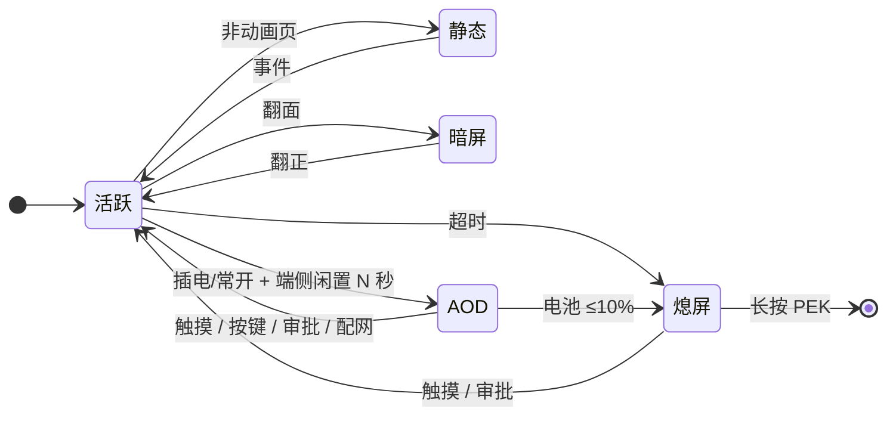

| 目标帧率 | 条件 | 依据 |
|---|---|---|
| `baseFps`（自适应 60/30、长续航 30/15、灵动 60） | 主屏动画、非浮层 | 插电 60 / 电池 30 |
| `min(baseFps,30)` | TOKENS 鲸群 | 一帧 63KB，喂不到 60；鱼是 ±2.6px 慢移，30 和 60 肉眼无差 |
| 60 | 拖拽 / fling / 转场 / 按下高亮 | 延迟必须 <16ms |
| 30 | 审批浮层 | 倒计时环 + 呼吸边框够用 |
| 10 | 其余静态页 | 事件驱动为主 |
| 4 | AOD | 只在分钟变化 / 30s 位移 / 状态变化时真画 |
| 5 | 熄屏 / 暗屏 | 只为防烧屏位移 |

- **AOD**：规则在 `model/aod_policy.h`（纯逻辑、可单测）。只有 `USB`/`ALWAYS` 允许进入；**进入只看端侧输入闲置**，宿主 `run/wait` 不参与；`min idle=30s`；姿态 `run>0→WORKING / wait>0→WAITING / 否则 SLEEP`；亮度封顶 59%（默认两档），夜间 23–07 压到 39%，翻扣压 0 但保持 AOD；防烧屏 = `burnOffset ±2px/30s` + `drift ±3px/10min`。
- **DFS**：`LIVELY` 240；`ADAPTIVE` 有插电或活跃需求 240，否则 80；`LONG_BATT` 熄屏 80、审批 160、其余 80；AOD 一律 80。
- **WiFi**：审批 / 配网 / 录音上传 / 交互后 5s 内 `WIFI_PS_NONE`，其余 `MAX_MODEM`；电池下按 RSSI 三档降发射功率（13/17/20dBm），插电满功率。

### 4.4 配网与在线

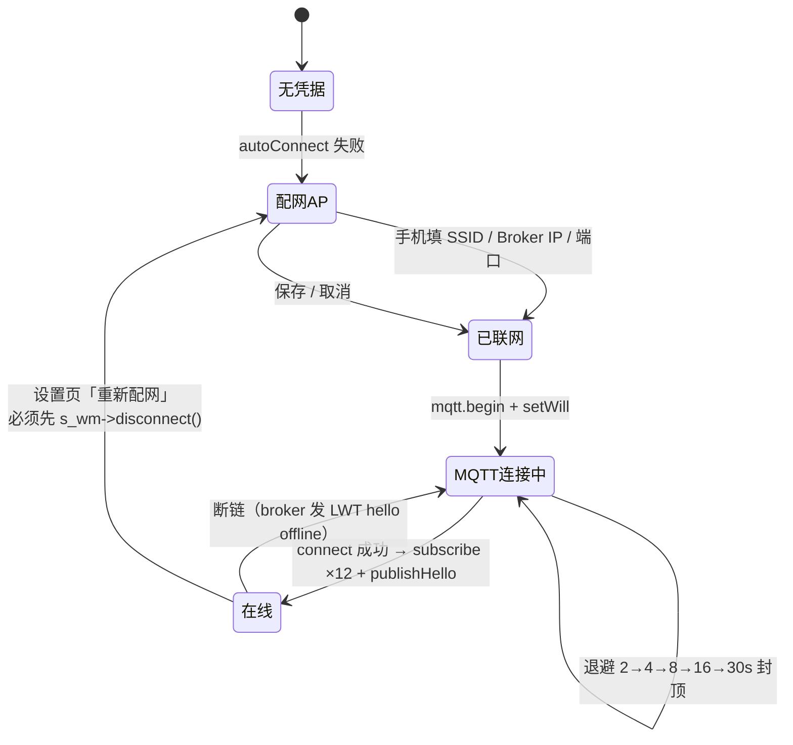

---

## 5. 渲染管线

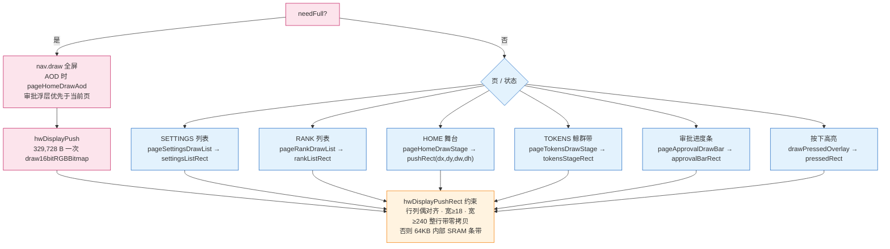

| 项 | 数值 / 规则 |
|---|---|
| 全屏推一帧 | ≈52ms（AOD 实测，含绘制）；所以全屏只用于切页 / 状态翻转 |
| 首页舞台 | ≈10.5ms（60fps 实测）；鲸群带 63KB @ 2.7MB/s ≈ 23ms → 锁 30fps |
| `pushRect` | 列/行偶对齐；宽 <18 会丢列；宽 ≥240 整行带零拷贝；其余走 64KB 内部 SRAM 条带 |
| 脏矩形口径 | 只推「内容真正活动的带」：鲸鱼只在 88px 里动，早期推 194px = 白搬 58%（27ms） |
| CHAT 页 | 无脏矩形：`recGen/chatGen/boardGen` 任一变化 → 全屏；录音中按 83ms 节流刷电平 |
| HOME 舞台 | 上一帧框 ∪ 本帧框；spark / Zzz / 气泡都在并集内画，超出即丢（不留残影） |

---

## 6. 不变量与坑（改之前先看这张表）

| # | 规则 | 违反的后果 |
|---|---|---|
| 1 | `err` 只能是字面量 `true`；异常原文走 `errMsg`；`msg` 不含「异常」 | 布尔求值成 0，错误态永不显示 / 误报 |
| 2 | `approval`、`choreo`、`tts`、`chat`、`mic_ack` 都不 retain | 重连重放幽灵弹窗 / 旧剧本 / 旧语音 |
| 3 | 审批同 `id` 幂等（不重置到达时间、不 `apGen++`） | 倒计时回满、到达音重播 |
| 4 | `ctx.tokenMeter` 在派发路径外求值；监听 `global:true`，审批 `prepend` | 回调第一行抛 inject 错误被吞成 warn：「事件到了但不执行」 |
| 5 | 会话日志按 `28 B5 2F FD` 逐帧解压 | `createZstdDecompress` 解完首帧即报 `Unknown frame descriptor` |
| 6 | 排他资源：I2C 只 `task_bus`（含麦克风增益寄存器）；canvas 只 `task_ui`；MQTT 句柄只 `task_net`；解码缓冲只 `task_decode` | 总线冲突 / 帧撕裂 / 句柄竞态 |
| 7 | `pushRect` 三条几何约束（偶对齐、宽≥18、≥240 整行带） | 丢列、花屏、撕裂 |
| 8 | AOD 期间禁止 `nvaSetState`；进入只看端侧闲置 | 站着睡；长任务把表盘顶掉 |
| 9 | 重配网先 `s_wm->disconnect()`；别用 `WiFi.disconnect(true,false)+AP_STA` | portal 下一轮自己关掉（「点了没反应」）/ 真机 panic |
| 10 | TTS 文本先压到 ≤40 显示宽（`clipForTts`） | 超 98304B 被静默丢弃，表现为「没声音」 |
| 11 | 设置键名逐字固定；新增项同时进 `kSettings`（NVS + prefs 共用） | 老设备读不到 / prefs 键错位 |
| 12 | 中文字段截断用 `novaSafeUtf8Copy` | 半个 UTF-8 字符 → 花屏方块 |
| 13 | 设备上行 JSON 受 448B 限制；下行不受（读缓冲 4096） | 上行截断成非法 JSON，宿主静默丢包 |
| 14 | 审批浮层期间 `animPage=false` | 驱动动画把浮层画回去覆盖 |
| 15 | SLEEP / YAWN 期间本地巡游与 choreo 都必须停步（`resting` 闸） | 熟睡的宠物被拉着「梦游」、顶着 Zzz 说元气台词 |
| 16 | 动作表五处同序，`0..8` 不许改序，新动作只追加 | 资产文件名、协议名、导演白名单三者错位，播出错动作 |
| 17 | 镜像只对 14 个白名单动作生效；新动作默认不镜像 | 带文字/道具的动作左右翻转后文字反了 |
| 18 | 舞台绘制与命中都用 `burnOffset`；粒子/气泡不许越出脏矩形 | 按钮点歪 2px、粒子残影 |
| 19 | 16MB 分区只覆盖 1.8 env，`spiffs` label 不可改名 | 其他板 8MB 装不下 24 包；改名后 `LittleFS.begin()` 挂载失败 |

---

## 7. 施工影响地图

| 改动点 | 影响模块 | 风险 | 必测 |
|---|---|---|---|
| `proto.cpp` 任一 `apply*` | NovaState → 所有页面 | 高 | `node tools/verify_state_payload.mjs` + 真机 `{"cmd":"stat"}` |
| `state.h` 加字段 | `novaStateInit` 的 memset 与所有整份拷贝点 | 中 | 编译 + 主屏/额度/榜单/审批四页 |
| `bridge.buildStatePayload` | 载荷体积、节流、主会话选择 | 高 | `cd host-plugin && npm test` |
| `bridge.onApprovalRequest` / `settleApproval` | 审批闭环、DSH waterfall 链 | **极高** | 真机点按 + 浏览器先答 + 超时三条路径 |
| `bridge.handleChatSend` / `chat` 回执 | 语音看板投递与回执 | 高 | `chat.test.mjs` + 真机一轮 |
| `sessions` 载荷 / 看板目标选择 | CHAT 页会话卡、草稿锁会话 | 中 | 切目标 + 目标失效场景 |
| `net.cpp` 的 `SUFFIXES` | 订阅与 `protoApplyMessage` 必须同步 | 高 | 12 个主题逐条收包 |
| `hw/bus.cpp` 周期 / 顺序 | 触摸延迟、I2C 掉线恢复 | 中 | 触摸拖拽 + 电池/RTC 读数 |
| `anim/nva.cpp` 解码缓冲 | 帧撕裂、内存（2×MAX_FRAME_PIXELS + xorScratch；常驻槽仍只有 IDLE/SUCCESS/ERROR 3 个） | 高 | 24 个动作各播一圈 |
| `hw/display.cpp` `pushRect` | 花屏 / 丢列 / 撕裂 | 高 | 各页脏矩形 + 全屏 |
| `pages.h` 新增 `UiAction` | `handleAction` 的 switch 必须补齐 | 中 | 新交互 + 现有交互回归 |
| `settings.h` 新字段 | NVS 键 + 默认值 + prefs | 中 | 断电重启仍生效 |
| `hw/audio.cpp` 录音 / 增益 | 录音电平、mic 上传 | 中 | `node tools/rec_receiver.mjs` |
| 帧率策略（`targetFps`） | 流畅度、功耗、`pushUs` | 中 | 每页 `{"cmd":"stat"}` 看 `pushUs` |
| `page_home.cpp` 交互 / 动作 / 脏矩形 | HOME 表现、AOD 表盘、点击热区 | 中高 | `bash tools/sim/check.sh`（`page_home_*` 基线）+ 真机戳戳乐 |
| 动作枚举 / 名字表（5 处） | 资产、协议、LLM 导演 | 中 | `bash tools/test_proto.sh` + `cd host-plugin && npm test`（choreo） |
| `convert_pet.py` / `no_ota_16mb.csv` | 资产体积与分区 | 高 | 重转 → `bash tools/prep_data.sh` → 全量烧录并确认 LittleFS 挂载 |
| AOD 进出与局部重绘条件 | 表盘、熄屏、功耗 | 中 | 停在各页进/出 AOD，确认没有局部分支往表盘上画 |

---

## 8. 模块耦合速查

| A | B | 关系 | 边界 |
|---|---|---|---|
| `task_net` | `proto.cpp` | 收包直接调 `protoApplyMessage` | 清晰：proto 只管编解码 + 写状态 |
| `task_ui` | `task_decode` / `task_bus` | 通知+信号量换 front 缓冲；快照 + 事件队列 | 清晰：UI 不碰 I2C，不共享解码缓冲 |
| `task_ui` | `hw/display` | 直接调 `hwDisplayPush*` | 有意破例：canvas 只归 UI |
| `task_net` | `settings` | 读 broker 配置；配网回调写 + `settingsSave` | ⚠️ 回调在 net 任务写 NVS，与 UI 的 `settingsMut()` 无锁 —— 实际只在 portal 期间 |
| `bridge.js` | DSH 事件 / `ctx.tokenMeter` | `global:true` + waterfall `prepend`；tokenMeter 派发外求值 | ⚠️ 见 §6-4 |
| `bridge.js` | `sessionController` | `list` 校验 + `follow` / `prompt` 投递 | 失败必须回 `chat{fail}`，不能静默 |
| `ai.js` | 外部 LLM / TTS / ASR | 主备两路、15–25s 超时 | 失败返回 null，不阻塞桥接 |
| `power.js` | `stat` / `pwr` 上行 | 有界日志 + CSV/MD 报告 | 只写 `~/.dsh/nova-buddy/` |

---

## 9. 改完怎么验

| 目的 | 命令 |
|---|---|
| **总回归**（改代码后必跑） | `bash tools/check_all.sh` —— proto / battery / AOD / settings 单测 + 状态载荷 + 录音自检 + 宿主 `node --test`（57）+ 51 项像素基线 + 裸 `368` 检查 |
| 只跑像素基线 | `bash tools/sim/check.sh`；出全部页面 PNG：`bash tools/sim/run.sh` → `tools/sim/out/` |
| 协议载荷 | `node tools/verify_state_payload.mjs` |
| 宿主单测 | `cd host-plugin && npm test` |
| 真机截图 | `python3 tools/usb_shot.py`（USB CDC，NVSH 帧） |
| 真机指标 | 串口 `{"cmd":"stat"}`；采样 `node tools/power_probe.mjs --id <ID> --minutes 30` |
| 录音链路 | `node tools/rec_receiver.mjs`（收片存 WAV + 回 `mic_ack`）；识别对拍 `node tools/asr_probe.mjs` |
| 机内语音条 | `node tools/assets/gen_voice.mjs [key…]`（本机 Qwen3-TTS + `host-plugin/assets/voice-ref.wav`）→ `assets/audio/*.adp`，再 `bash tools/prep_data.sh` |
| 烧录 | `bash tools/pio.sh run -e waveshare-esp32s3-touch-amoled-1-8` |
| 本文图 | 抽出 mermaid 后 `mmdc -p /tmp/pptr.json -i x.mmd -o x.png -w 1500 -b white`（`pptr` 配置 `{"args":["--no-sandbox"]}`）；`-o /dev/null` 只验语法 |
