# Nova Buddy — 架构参考

> **状态**: ✅ 与代码同步
> **上次同步提交**: `a787b49`（分支 `feature/whale-tokens`）
> **生成日期**: 2026-11-22
> **生成方式**: architect-mermaid skill（读码 + mmdc 语法校验）
> **图目录**: [docs/diagrams/](diagrams/)（13 张图的 PNG 导出，`-w 1500 -b white`，与本文 mermaid 源码一一对应）
> **上游设计书**: [NOVA-BUDDY-PLAN.md](NOVA-BUDDY-PLAN.md)（需求与决策依据）；本文只描述**代码现在是什么样**

---

## 0. 项目速览

| 项 | 内容 |
|---|---|
| 形态 | 桌面副屏 + 桌面宠物。Mac 侧算事实，ESP32 侧管感觉 |
| 设备 | Waveshare ESP32-S3-Touch-AMOLED-1.8（368×448，SH8601 QSPI + FT3168 触摸） |
| 固件 | Arduino / PlatformIO（`env:waveshare-esp32s3-touch-amoled-1-8`），-O2，8MB 无 OTA 分区 |
| 宿主 | DSH 插件 `host-plugin/`（`dsh-plugin-nova-buddy` v0.3.0，ESM，唯一运行依赖 `mqtt`） |
| 链路 | WiFi + MQTT，broker 局域网匿名，`nova/<deviceId>/…`，QoS1 + retain + LWT |
| 六条主线 | 宠物动画 / 订阅额度 / ModelDial 榜单 / 工具审批 / Token 统计 / 配置与配网 |
| 关键约束 | I2C 只有 `task_bus` 能碰；canvas 只有 `task_ui` 能碰；`err` 字段只能是字面量 `true` |

### 0.1 目录结构

```text
nova-buddy/
├── src/                       固件（PlatformIO 只在 src/ 下编译）
│   ├── main.cpp               task_ui 全流程：串口命令、输入分发、动作、脏矩形决策、帧率与 DFS
│   ├── anim/nva.{h,cpp}       .nva 包解析 + zlib + XOR 帧差 + 双缓冲 + task_decode
│   ├── audio/sfx.{h,cpp}      提示音序列（调 hwTone / hwPlayAdpcmFile）
│   ├── boards/                5 块板子的引脚与屏参（本项目只用 1.8）
│   ├── hw/                    bus / display / input / audio / power / rtc / imu / expander / border
│   ├── model/                 settings（NVS）+ state（互斥锁全局状态）
│   ├── net/                   net.cpp（WiFiManager + MQTT 任务）+ proto.cpp（JSON 编解码）
│   ├── ui/                    canvas / theme / pages / nav / transition / aafont_data（6.9MB 字体）
│   └── [未接入] character.* / buddies/ / ble_bridge* / data.h / xfer.h / stats.h / ui/p0_demo.cpp
├── host-plugin/               DSH 插件
│   ├── index.js               cordis 入口：inject tokenMeter，注册 3 个 global 监听
│   ├── lib/bridge.js          会话聚合、审批仲裁、MQTT 发布与定时器
│   ├── lib/fetchers.js        4 个出网抓取器 + 磁盘缓存（~/.dsh/nova-buddy/cache.json）
│   ├── lib/tokens.js          session 日志 → 按日 token 聚合
│   ├── lib/ai.js              LLM 动作剧本 + MiMo TTS → NVAD ADPCM
│   ├── lib/adpcm.js           WAV → NVAD 4bit ADPCM
│   ├── bin/nova-buddy.js      CLI：auth / test-push / test-choreo / test-tts
│   └── test/                  14 个单测（bridge + tokens）
├── tools/
│   ├── sim/                   Mac 主机 PNG 模拟器（共用同一套 ui/ 源码，-DNOVA_HOST_SIM）
│   ├── assets/convert_pet.py  GIF/视频 → .nva
│   ├── fonts/gen_aafonts.py   4-bpp 抗锯齿字体生成
│   ├── usb_shot.py            USB CDC 截图（NVSH 帧）
│   ├── verify_state_payload.mjs  state 载荷全链路断言（不需要真机/broker）
│   ├── prep_data.sh           assets → data（LittleFS 镜像源目录）
│   └── pio.sh                 PlatformIO 包装（绕开坏符号链接）
├── assets/pets/nova/*.nva     9 个动画包；data/pets/nova 是打包产物
├── deploy/mosquitto/          broker 的 docker-compose 与配置
└── docs/                      设计书、架构（本文）、previews 截图
```

> **未接入 ≠ 已删除**：`character.cpp`（GIF 通道）、`buddy.cpp`、`src/buddies/*`（18 个 ASCII 宠物）、`ble_bridge*`（旧 BLE 链路）、`data.h`/`stats.h`/`xfer.h`（旧 BLE 载荷与统计）都还在仓库里，但已无调用方。S3 环境用 `build_src_filter` 剔掉了 `buddies/`、`buddy.cpp`、`ble_bridge*`、`xfer.h`、`ui/p0_demo.cpp`；`character.cpp` 仍被 `+<*>` 收进编译 —— 它是当前唯一的编译负担（固件 2.6 MB / 8 MB，余量充足，暂不动）。

---

## 1. 系统分层架构

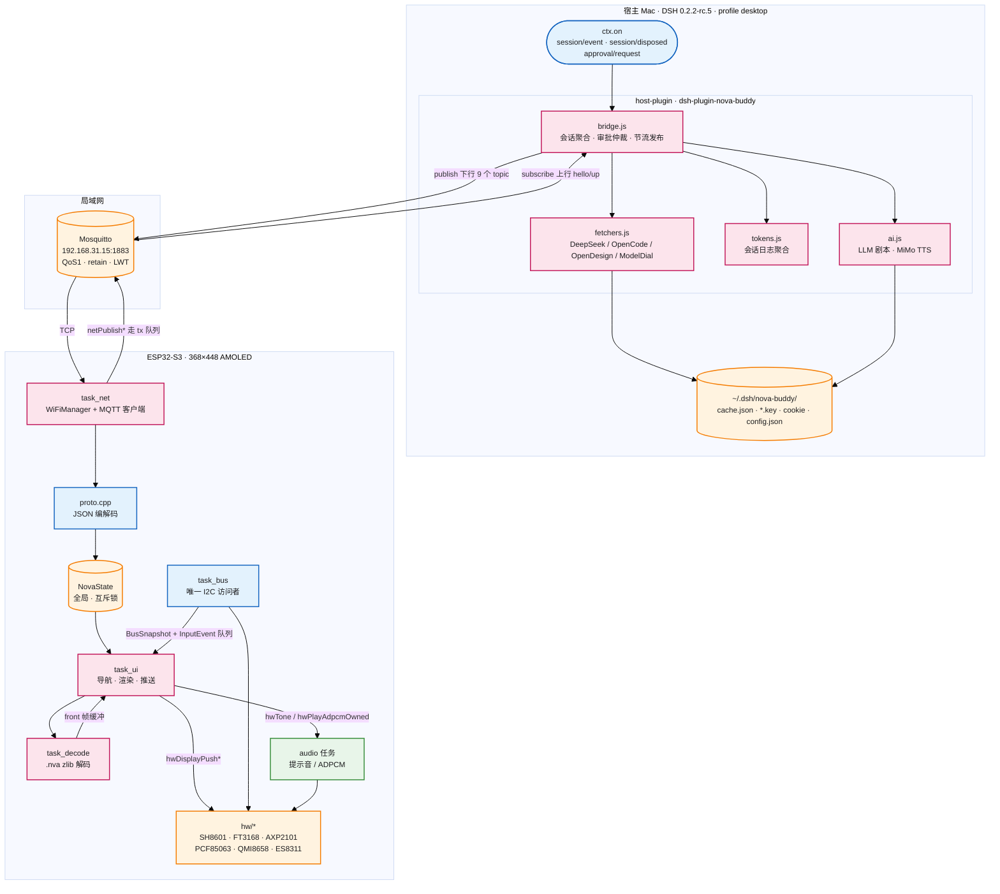

**图注**：左边是事实来源（凭据、DSH 事件、出网抓取），右边是感觉（渲染、动画、音效）。**设备不碰网、不碰密钥**；Mac 不碰像素。跨界的唯一通道是 MQTT 上 11 个 topic（9 下行 + 2 上行）。

---

## 2. 设备端源码依赖（文件级，不含未接入模块）

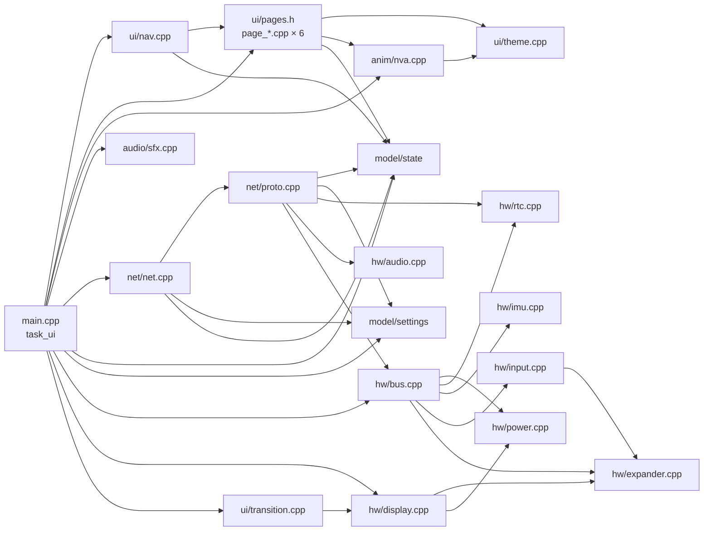

**图注**：`proto.cpp` 是唯一同时依赖 `state` + `settings` + `rtc` + `audio` + `bus` 的模块 —— 它是下行数据的落点，所有"网上的东西变成设备状态"的关系都从这里出发。`net.cpp` 不直接写 `NovaState` 的业务字段（只写连接状态），避免两个任务争一张表。

---

## 3. RTOS 任务划分（核心：谁在做什么）

| 任务 | 核 | 优先 | 栈 | 周期 / 触发 | 独占资源 | 干什么 |
|---|---|---|---|---|---|---|
| `task_ui` | 1 | 5 | 10240 | deadline 16.6ms（按目标帧率变） | **canvas / framebuffer** | 串口命令、输入事件、动作分发、页面绘制、脏矩形推送、动画状态机、CPU DFS、熄屏/防烧屏 |
| `task_bus` | 0 | 6 | 4096 | 20ms（4ms×5 切片，触摸 IRQ 提前打断） | **I2C 总线** | 触摸/按键/PEK 采样、电池（每 50 tick）、RTC（每 10 tick）、IMU 翻面判定；写 `BusSnapshot`，投 `InputEvent` 队列 |
| `task_net` | 0 | 4 | 12288 | 25ms 轮询（配网时 10ms） | **WiFi / MQTT 句柄** | WiFiManager captive portal、MQTT 连接与退避重连、订阅 9 topic、收包→`protoApplyMessage`、排空发送队列、30s 上报 stat、PS 档位切换 |
| `task_decode` | 1 | 3 | 8192 | `ulTaskNotifyTake` 事件驱动 | **.nva 解码缓冲** | zlib 解压 + XOR 帧差 → 写后缓冲，成功后切 `s_frontIdx` 供 UI 取用 |
| `audio` | 任意 | 5 | 4096 | 队列（深 16） | **I2S / ES8311** | 提示音（带包络滑音）、ADPCM 文件/内存播放；`voiceGen` 代际号丢弃过期请求 |
| `loop()` | — | — | — | — | — | 空转 `vTaskDelay(portMAX_DELAY)`，主循环已全部搬进任务 |

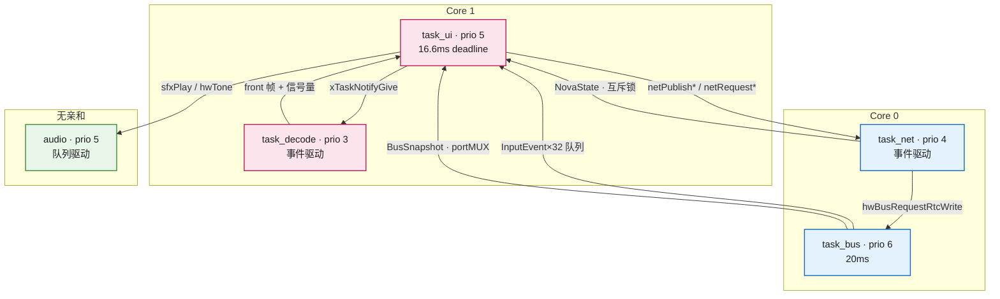

**图注**：跨任务同步有三套机制，别混用 —— ① `BusSnapshot` 用 `portMUX` 临界区（只拷 POD、极短）；② `NovaState` 用互斥锁（结构体 3KB+，读也整份拷）；③ 事件/请求走 FreeRTOS 队列。`task_ui` 与 `task_decode` 同在 Core 1 是有意的：解码低优先级，取不到新帧就重复上一帧，**不许解压阻塞渲染**。

### 3.1 `task_ui` 单帧流程

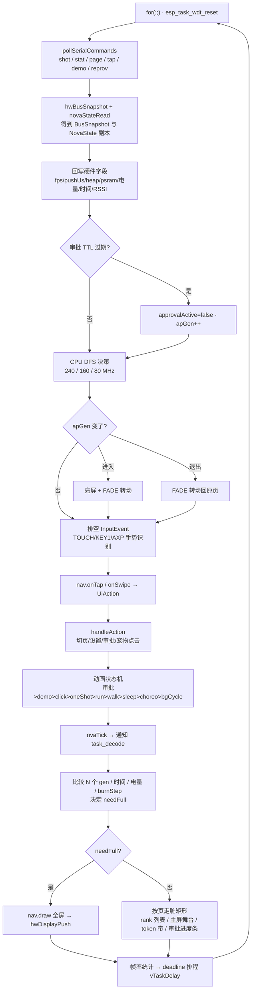

---

## 4. 数据传递

### 4.1 通道总表（MQTT 主题树）

前缀 `nova/`，`<id>` = MAC 后 3 字节（如 `D93468`）。

| Topic | 方向 | QoS | retain | 载荷要点 | 生产方 → 消费方 |
|---|---|---|---|---|---|
| `state` | ↓ | 1 | ✅ | run/wait/sess/msg/ctx.pct/model/title/tool/err/errMsg（`msg`/`title` 由宿主清洗成单行短文本） | bridge.flushState → applyState |
| `quota` | ↓ | 1 | ✅ | 3 张卡：bal / win(2 条 bar) / na(why) | 5min 定时 + 连接 + sync |
| `rank` | ↓ | 1 | ✅ | 前 8 行 + src/lic/at | 6h TTL + force |
| `tokens` | ↓ | 1 | ✅ | total/spanDays/cachePct/days[14] | 60s，内容不变不重发 |
| `approval` | ↓ | 1 | ❌ | id/tool/reason/ttl | 事件驱动，**不能 retain** |
| `approval_end` | ↓ | 1 | ❌ | id | 超时/浏览器先答了 |
| `time` | ↓ | 0 | ✅ | epoch + tz | 30s 心跳 + hello 时 |
| `choreo` | ↓ | 1 | ❌ | mood + `at` + ≤6 步 {x,speed,anim,dur,say} | 15min + turn-end 120s 冷却；**不 retain**（否则冷启动重放旧剧本），设备重连由 hello 补推 15 分钟内的 |
| `tts` | ↓ | 1 | ❌ | id/seq/tot/b64（1800B 一片） | 事件驱动，分片 |
| `hello` | ↑ | 1 | (LWT retain) | online + hello{w,h,fps,ip,pwr,aod} + prefs | 连接时 / LWT 断线 |
| `up` | ↑ | 1 | ❌ | evt=decision/stat/prefs/sync；`stat` 含 drawFps/pushUs/idle/draws/pwr/brt/lcd/aod/cpu{ui,dec} | 设备主动，默认 30s（`{"cmd":"statrate"}` 可临时改密） |

> **为什么 `approval` 不 retain**：retain 会在设备重连时重放一条早该消失的审批，用户会看到幽灵弹窗。审批走 QoS1 在线投递 + 两端 TTL 自毁。

### 4.2 状态主链路（DSH 事件 → 屏幕）

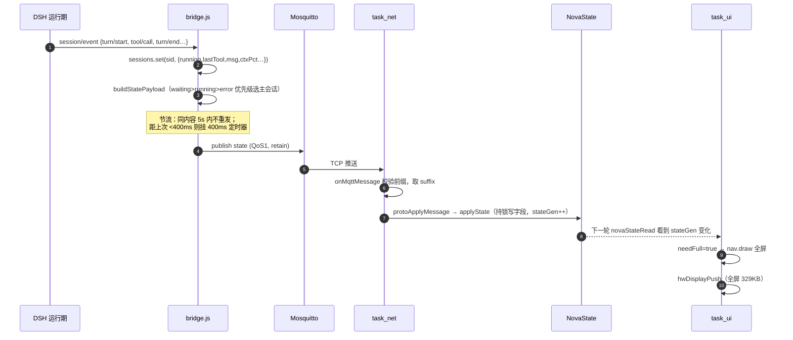

**要点**
- `err` 字段只能是字面量 `true`：`doc["err"] | false` 对 `1`/`"true"`/对象一律求值 0。异常原文走平级 `errMsg`。
- `msg` 里**不许出现「异常」二字**：`applyState` 有 `strstr(st.msg, "异常")` 兜底判定，会误报。
- `ctx.pct` 来自 `tokenMeter.contextPressure(session)`，只在 `turn/end` 与 `step/end` 两个事件点采样 —— DSH 没有 usage 事件。
- 上下文占用必须**在派发路径外**求值 `ctx.tokenMeter`（`inject` 门槛），否则回调第一行就抛、被吞成 warn，表现是"事件到了但没执行"。

### 4.3 审批闭环（唯一有真延迟要求的一条）

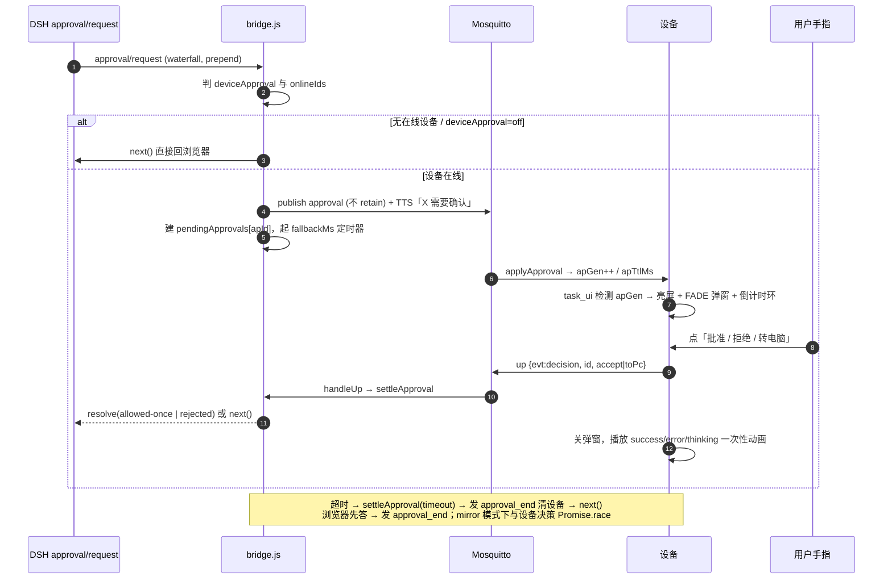

**默认值**（`index.js` 传入）：`deviceApproval='mirror'`、`fallbackMs=20000`（`bridge.js` 内部缺省仍是 8000）。`mirror` = 设备与浏览器谁先答听谁的；`prefer` = 只等设备，超时才回退。

### 4.4 三条出网抓取支线

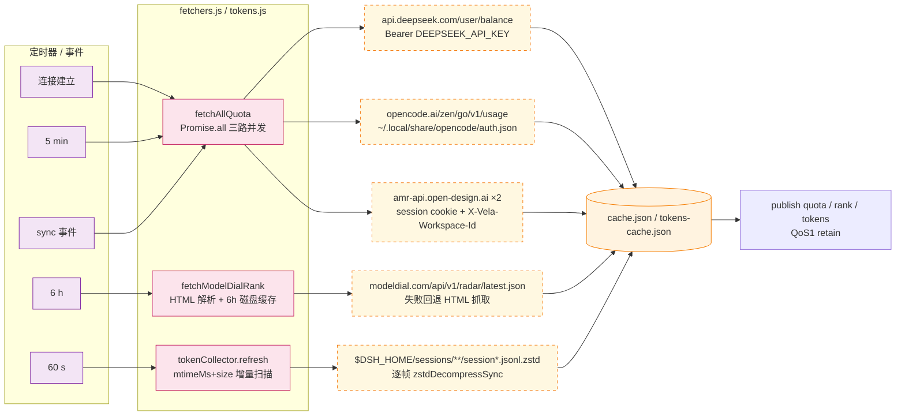

**失败域是独立的**：某个源 401/403 → 该卡 `kind:'na'` + `why:'reauth'`，其余照常；超时 → 用缓存 + `ageSec`；OpenDesign 没 cookie → `no-session`，整页不阻塞。

**token 页为什么读日志不走 ctx**：`ctx.sessions.list()` 只列当前进程内的 live session，拿不到历史，而累计页要的正是历史。DSH 的 session 文件是逐条 append 的**多帧** zstd 流，`createZstdDecompress` 解完第一帧就报 `Unknown frame descriptor`，所以按 magic `28 B5 2F FD` 切帧逐帧 `zstdDecompressSync`。口径与 tokenMeter 对齐：同一 `(turn, step)` 后到样本**替换**前者；按事件 `time` 归日。缓存按 `mtimeMs + size` 增量（首扫 4.5s / 1094 会话，之后 ~100ms）。

### 4.5 宠物：从 LLM 剧本到动作

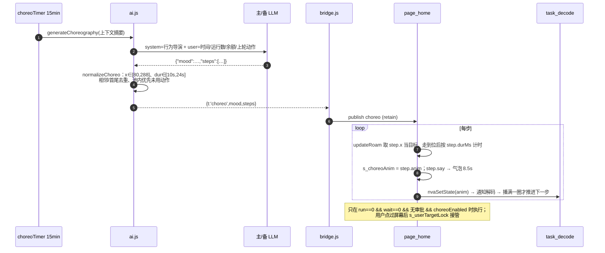

`anim` 取值被两处收口到同一套枚举：`VALID_ANIMS`（ai.js）与 `animNameToIdx`（proto.cpp），共 9 个：idle / thinking / working / waiting / success / error / click / sleep / quota。

### 4.6 语音：TTS 到喇叭

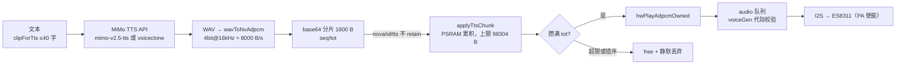

**两条硬规矩**：① 单条上限 98304 B ≈ 12.3 秒 ≈ 43–55 汉字，超了 `applyTtsChunk` 直接丢弃且**无任何提示**，所以必须在合成前压到 40 字内；② `force:true` 会让 4 秒节流失效，必须配 `ttsDedupHit` 30s 去重，否则连续异常语音串成一片。设备侧还要过三道闸：`ttsEnabled`、`soundPct>0`、夜间静音（23–08）。

---

## 5. 状态机

### 5.1 页面导航

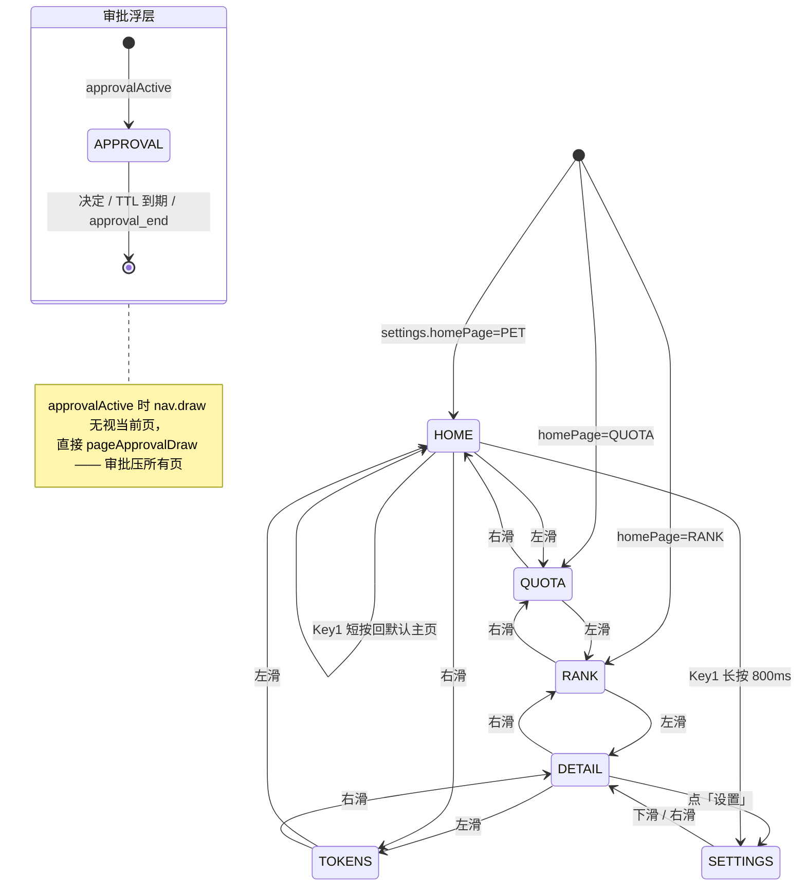

环序由 `kPageRing` 固定为 `TOKENS → HOME → QUOTA → RANK → DETAIL`；滑动阈值 `|dx| ≥ 48 && |dx| > |dy|`。

### 5.2 电源与帧率

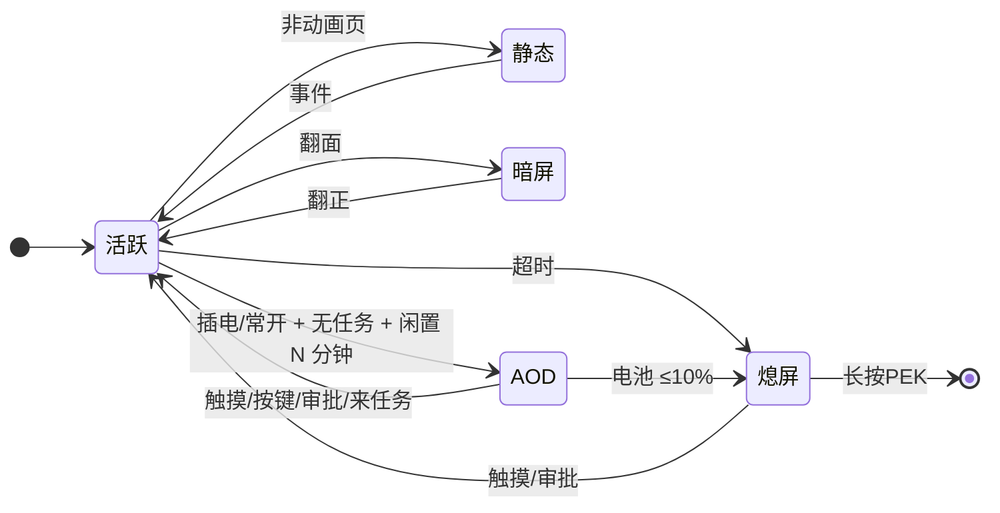

**图注**：`活跃` 指主屏动画或转场；`静态` 指详情/额度/榜单/Token 页（事件驱动，10fps 兜底）；`熄屏` 由 `cfg.batSleepSec` 触发（插电不熄屏）；`暗屏` 是翻面 `faceDown` 的降亮，不关面板 —— 免得唤醒走 9 步复位时序、出画要一两百毫秒；`AOD` 是 0.5.0 加的熄屏待机构图（DIN 92 大时钟 + 定格姿势 + 运行状态行），规则在 `model/aod_policy.h`，主循环只在进入/退出时改状态。**进入只看端侧输入闲置时长**，宿主 `run/wait` 不参与（长任务也进表盘）；姿势 `run>0→WORKING / wait>0→WAITING / 否则 SLEEP`。

| 目标帧率 | 条件 | 依据 |
|---|---|---|
| `baseFps`（自适应 60/30、长续航 30/15、灵动 60） | 主屏且非浮层 | 插电 60、电池 30 |
| `min(baseFps, 30)` | TOKENS 页鱼群动画 | 一帧搬 63KB，实测带宽 2.7MB/s → 23ms，喂不到 60；鱼是 ±2.6px 慢速微动，30 和 60 肉眼无差 |
| 60 | 拖拽 / fling / 转场中 | 延迟必须 <16ms |
| 30 | 审批浮层 | 倒计时环 + 呼吸边框够用 |
| 10 | 其余静态页 | 事件驱动为主 |
| 4 | AOD 待机 | 只在分钟变化 / 30s 位移 / 状态变化时真画；实测 5 次/分钟 |
| 5 | 熄屏 / 暗屏 | 只为防烧屏位移 |

CPU DFS 三档：`LIVELY` 恒 240MHz；`ADAPTIVE` 插电/活跃 240，否则 80；`LONG_BATT` 熄屏/暗屏 80、审批 160、其余 80；**AOD 一律 80**。WiFi PS：审批中 / 配网 / 交互后 5s 内 `WIFI_PS_NONE`，其余 `WIFI_PS_MAX_MODEM` + `listen_interval=10`。

**AOD 亮度**：`min(用户档, 2)`，23–07 点再压到 1 档；翻扣时亮度 0 但保持 AOD 状态。防烧屏 = burnOffset ±2px/30s + `aod::drift` ±3px/10min + 亮度封顶。

### 5.3 设备在线状态

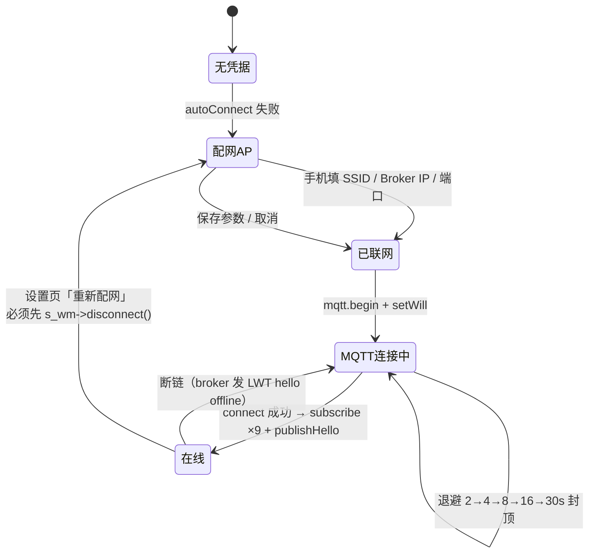

**坑（已修，别踩回去）**：「重新配网」必须先 `s_wm->disconnect()` 再开 portal —— STA 还连着时 `wifiUp` 恒 true，主循环那条 `if (wifiUp && s_portalActive) stopConfigPortal()` 会在下一轮把 portal 自己关掉，表现是"点了没反应"。`WiFi.disconnect(true,false)+AP_STA` 的写法会真机 panic。

---

## 6. 渲染管线与脏矩形

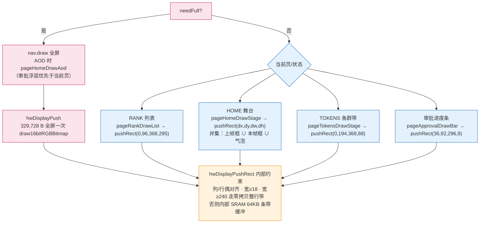

**图注 / 成本**：全屏 329,728 B ÷ 实测 2.7 MB/s ≈ 12ms（批量写）；`pushRect` 对 SH8601 有三条硬约束 —— 列/行窗口必须偶对齐、宽度 <18 会被丢列、宽 ≥240 时直接整行带零拷贝。**脏矩形面积要按"内容真正活动的带"算**：鱼只在 88px 里活动，早期推 194px 等于白搬 58% 像素（27ms）。

**浮层必须锁全量重绘**：驱动动画走 `pageHomeDrawStage`，只重画舞台不经过 `pageHomeDraw`，浮层画完会被动画覆盖。所以 `dockExpanded && turnError` 期间 `animPage` 强制为 false。

---

## 7. 施工影响地图

| 改动点 | 影响模块 | 风险 | 必测 |
|---|---|---|---|
| `proto.cpp` 任一 `apply*` | NovaState 字段 → 所有页面 | 高 | `node tools/verify_state_payload.mjs` + 真机 `{"cmd":"stat"}` |
| `state.h` 加字段 | `novaStateInit` 的 memset 与所有 `NovaState` 拷贝点（栈上拷贝很常见） | 中 | 编译 + 主屏/额度/榜单/审批四页 |
| `bridge.js` `buildStatePayload` | 载荷体积、节流、主会话选择 | 高 | `host-plugin/test/bridge.test.mjs` |
| `bridge.js` `onApprovalRequest` | 审批闭环、DSH waterfall 链 | **极高** | 真机点按 + 浏览器先答 + 超时三条路径 |
| `net.cpp` 订阅列表 | 主题与 `SUFFIXES` 必须同步 | 高 | 九主题逐条收包 |
| `bus.cpp` 周期/顺序 | 触摸延迟、I2C 掉线恢复 | 中 | 触摸拖拽 + 电池/RTC 读数 |
| `nva.cpp` 解码缓冲 | 帧撕裂、内存（2×MAX_FRAME_PIXELS + xorScratch） | 高 | 9 状态逐个播完一圈 |
| `display.cpp` `pushRect` | 花屏/丢列/撕裂 | 高 | 各页脏矩形 + 全屏 |
| `pages.h` 新增 `UiAction` | `handleAction` 的 switch 必须补齐 | 中 | 新交互 + 现有交互回归 |
| `settings.h` 新字段 | NVS key + `settingsLoad` 默认值 | 中 | 断电重启后仍生效 |
| 帧率策略（`targetFps`） | 主观流畅度、功耗、`pushUs` | 中 | 每页 `{"cmd":"stat"}` 看 `pushUs` |

## 8. 模块耦合速查

| A | B | 关系 | 边界 |
|---|---|---|---|
| `task_net` | `proto.cpp` | 收包直接调 `protoApplyMessage` | 清晰：proto 只管编解码 + 写状态 |
| `proto.cpp` | `NovaState` | `novaStateWithLock` 写 | 清晰：无跨任务裸写 |
| `task_ui` | `task_decode` | `xTaskNotifyGive` / 信号量换 front 缓冲 | 清晰：双缓冲，不共享写 |
| `task_ui` | `task_bus` | 快照 + 事件队列 | 清晰：UI 从不碰 I2C |
| `task_ui` | `hw/display` | 直接调 `hwDisplayPush*` | 有意破例：canvas 只归 UI |
| `task_net` | `settings` | 读 broker 配置；`onSaveParams` 写 + `settingsSave` | ⚠️ 配网回调在 net 任务里写 NVS，与 UI 的 `settingsMut()` 无锁 —— 实际只在 portal 期间发生 |
| `bridge.js` | DSH 事件 | cordis `global:true` + waterfall `prepend` | ⚠️ 必须 global，否则 profile 根作用域收不到 agent scope 事件 |
| `bridge.js` | `ctx.tokenMeter` | 派发路径外求值一次 | ⚠️ 回调里直接访问会抛 inject 错误并被吞 |
| `ai.js` | 外部 LLM / TTS | 主备两路、25s 超时 | 清晰：失败即返回 null，不阻塞桥接 |

---

## 9. 文档维护规则

| 章节 | 维护方式 | 变更触发 |
|---|---|---|
| §0.1 目录 | 手动 | 新增/删除一级模块 |
| §1 分层架构 | 手动 | 跨层依赖变化（如加第二个传输通道） |
| §3 任务表 | 手动 | `xTaskCreate*` 增删、优先级/栈/周期变更 |
| §4 主题表 | 手动 | `subscribeTopics` 或 `publishTo` 的 suffix 变化 |
| §4.x 时序图 | 手动 | `bridge.js` 上述高亮函数签名或流程变化 |
| §5 状态机 | 手动 | `UiAction`/`UiPage` 枚举、`kPageRing`、电源档位变化 |
| §6 渲染管线 | 手动 | `needFull` 分支或 `pushRect` 参数变化 |
| §7/§8 表格 | 每次改动顺手补 | — |

**同步纪律**：改完任何一个 §7 高亮点，回来把 `上次同步提交` 改成新的 HEAD；如果图里出现代码里已经不存在的名字，先删图里的节点，再删代码 —— 顺序反了就会留下幻影连接。

**验证手法**（本次已跑）：

```bash
# 图语法
awk '/^```mermaid$/ {f=1;b="";n++;next} /^```$/&&f {f=0; printf "%s",b > "/tmp/d"n".mmd"; next} f {b=b $0 "\n"}' docs/ARCHITECTURE.md
for f in /tmp/d*.mmd; do mmdc -p /tmp/pptr.json -i "$f" -o /dev/null 2>&1 | tail -1; done
```

> `mmdc` 在本机需要 `-p` 传 `--no-sandbox`（puppeteer 默认沙箱在本机会 30s 超时），配置：`{"args":["--no-sandbox","--disable-setuid-sandbox","--disable-dev-shm-usage"]}`。
